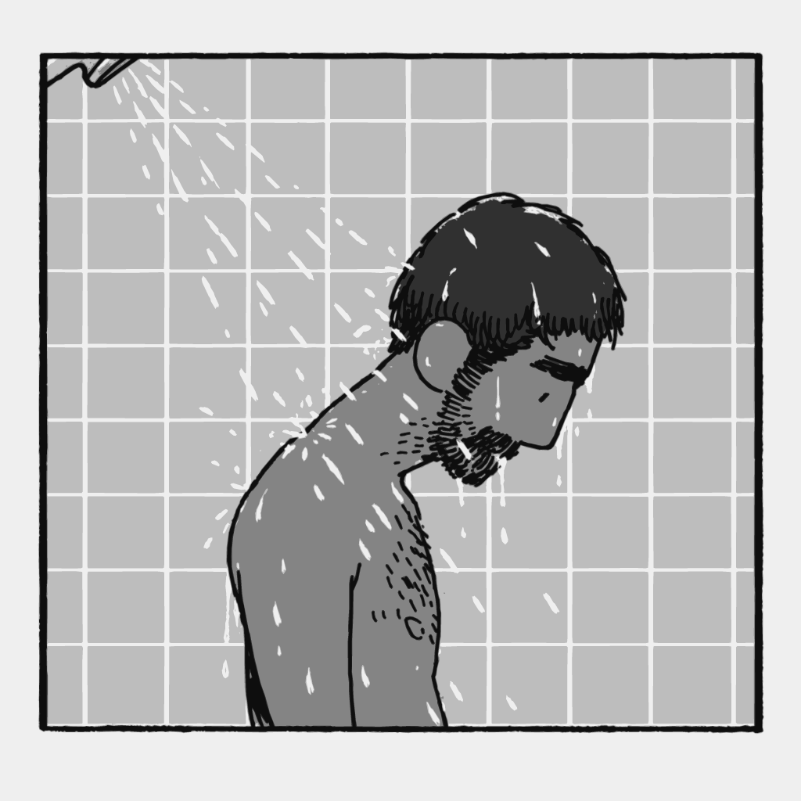
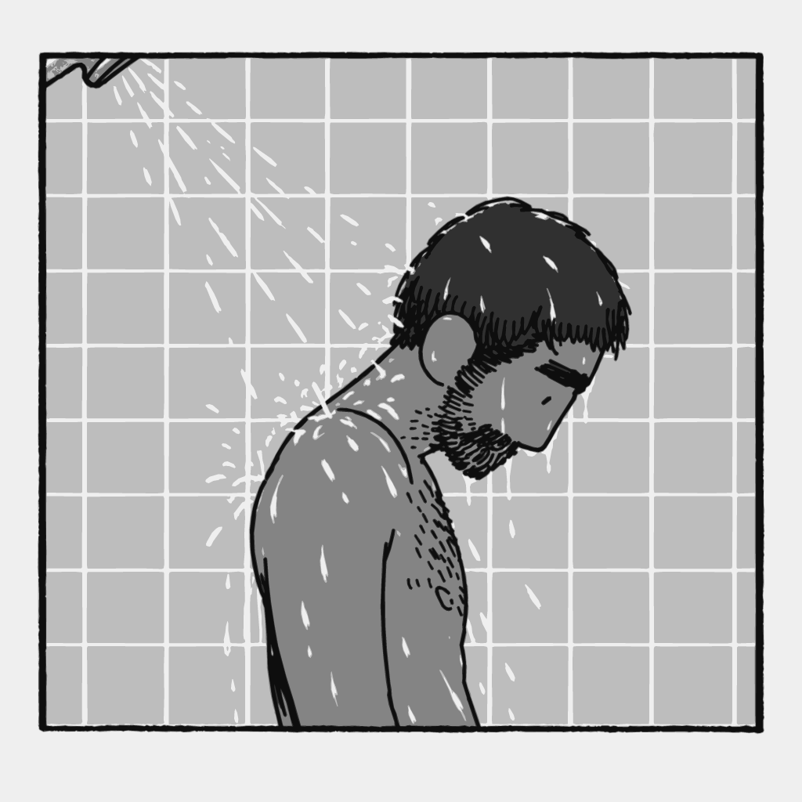
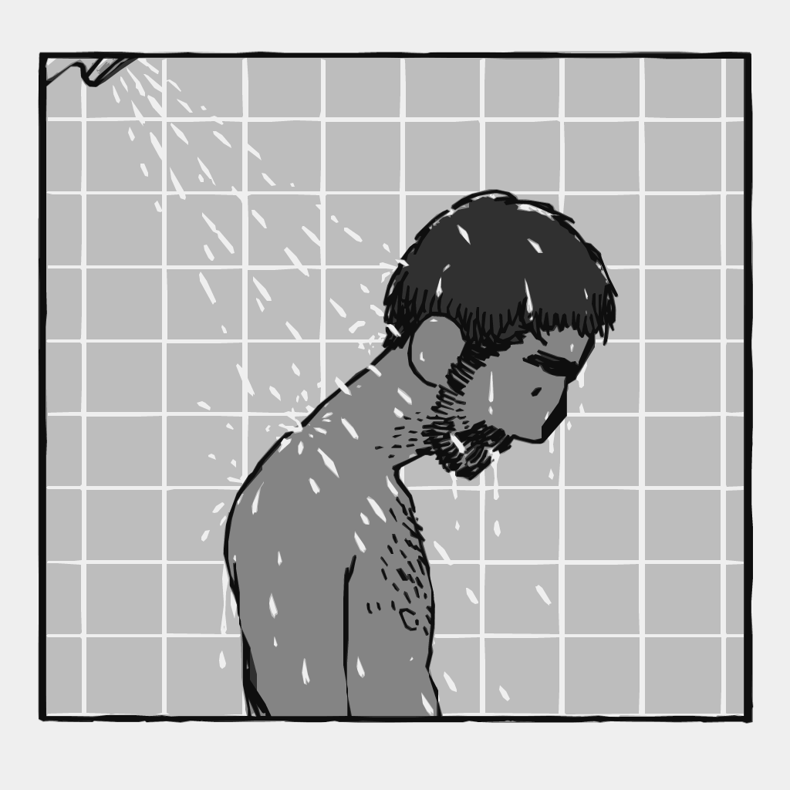
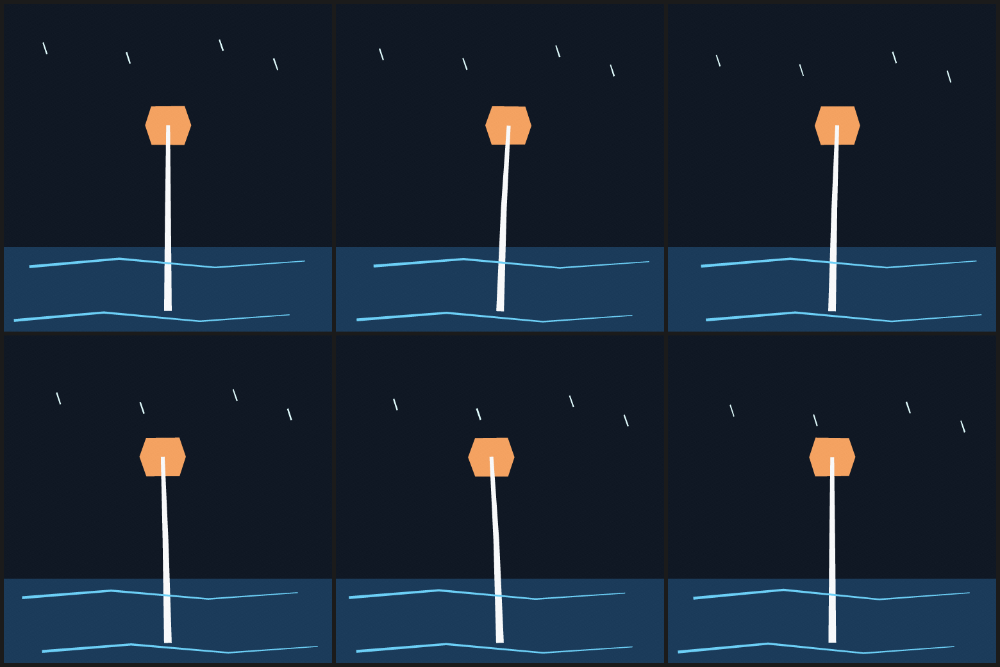

# Gallery

Real renders from this repository, not mock-ups. Each image says which file and
frame produced it and how to reproduce it. Every PNG here is generated by
`docs/scripts/build_docs_assets.py` with the reference renderer (the labelled
native renderer produces the same picture; see
[architecture](architecture.md#determinism-guarantees)).

## The shower frames

The two *Man in the Shower* frames are the original reconstruction benchmark.
They are traced contours, not hand-authored primitives, which is why the files
are large: every wet hair strand and beard bristle is stored.

<!-- image: assets/gallery/shower_f0001.png -->


*Source:* [`python/northcel/examples/shower_f0001.ncel`](../python/northcel/examples/shower_f0001.ncel) ·
*command:* `northcel render python/northcel/examples/shower_f0001.ncel -o shower_f0001.png` ·
66,178 bytes / 44,881 cl100k tokens.

<!-- image: assets/gallery/shower_f0002.png -->


*Source:* [`python/northcel/examples/shower_f0002.ncel`](../python/northcel/examples/shower_f0002.ncel) ·
65,082 bytes / 43,828 cl100k tokens.

<!-- image: assets/gallery/shower_f0001_compact.png -->


*Source:* [`python/northcel/examples/shower_f0001_compact.ncel`](../python/northcel/examples/shower_f0001_compact.ncel) ·
`precision: 1px` · 14,686 bytes / 9,465 cl100k tokens. At normal viewing size it
is hard to tell from the 0.25px render; the measured SSIM gap is in
[examples](examples.md).

## The lantern film

The lantern is a hand-authored 6-frame film (`def`/`use`, strokes, a ribbon, a
`bend_swarm`, colour and `boil`) in about one kilobyte. One contact sheet instead
of six images.

<!-- image: assets/gallery/lantern_film_sheet.png -->


*Source:* [`python/northcel/examples/lantern_film.ncel`](../python/northcel/examples/lantern_film.ncel) ·
*command:* `northcel film python/northcel/examples/lantern_film.ncel -o frames/ --frames 0..5` ·
1,068 bytes / 458 cl100k tokens for the whole film.

## Fitted Test Video 7

The 90-frame fitted recreation of *Test Video 7* is the Phase B benchmark: 90
drawings at 1536×864, three fitted tiers (0.25px text, 0.25px-b63 + palette, 1px
Base-63). The 90 frames are **not** committed here: that would add megabytes of
raster to a language repository for a benchmark. The measured comparison lives in
[examples](examples.md) and the existing contact sheet is
[`assets/tv7_contact_sheet.png`](assets/tv7_contact_sheet.png) (click to open; a contact
sheet of the benchmark frames, not the 90 separate images).

The AI-authored single frame `tv7_f0076_ai_cel.ncel` (seated man + duck, 6,306
bytes / 4,438 tokens) is also in
[`python/northcel/examples/`](../python/northcel/examples/tv7_f0076_ai_cel.ncel).
It renders with the same command:

```console
$ northcel render python/northcel/examples/tv7_f0076_ai_cel.ncel -o tv7_f0076.png
```

## The new pattern examples

All ten are on the [patterns index](patterns/README.md), each with a contact
sheet of every frame. They are the best place to start copying: the shower and
TV7 files are tracing benchmarks, while the patterns are authored drawings.

| | | |
| --- | --- | --- |
| [Head turn](patterns/01-head-turn-6fps.md) | [Blink](patterns/02-blink.md) | [Jump](patterns/03-jump-anticipation-squash.md) |
| [Colour beat](patterns/04-colour-beat.md) | [Cloud drift](patterns/05-cloud-drift.md) | [Assembly](patterns/06-progressive-assembly.md) |
| [Duck walk](patterns/07-duck-walk.md) | [Line boil](patterns/08-line-boil.md) | [Crowd](patterns/09-crowd-swarm.md) |
| [Two-shot](patterns/10-two-shot.md) | | |

## Size and provenance

The whole gallery adds `docs/assets/gallery/` (~0.53 MB) and the pattern sheets
add `docs/assets/patterns/` (~0.25 MB); the guide figures add
`docs/assets/guide/` (~0.17 MB). The build prints the exact total, and
[the report](https://github.com/syver777/northcel) records it per release. No
video files are committed.

Every image is a PNG at the document's own resolution (contact sheets are
composites at the frames' resolution). The renderer is recorded in
`docs/scripts/expected.json`; the docs check recomputes each image and compares
its pixels, so a stale or hand-edited image fails CI.
