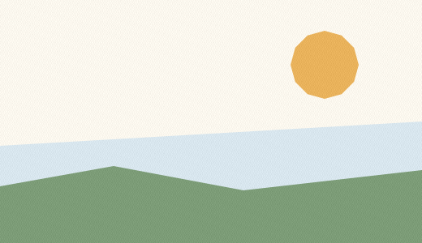

# 3. Paper and canvas

Every scene starts with paper: a rectangle of one colour, optionally textured
with a deterministic grain. The canvas size is the `width`/`height` of the root
container.

## The header attributes

| Attribute | Range | Default | Effect |
| --- | --- | --- | --- |
| `width`, `height` | `1..8192` | `1024` | output pixel size |
| `fps` | `1..240` | `6` | timing metadata; `film` uses it for duration |
| `precision` | `0.25px`, `0.25px-b63`, `1px` | `0.25px` | how every contour payload is decoded |
| `seed` | any integer | `42` | the only source of "randomness" (`boil`, swarms) |

## `paper`

`paper` may be written with braces or parentheses:

```text
paper { color: #F6F1E7, antialias_grid: 4, grain: 0.01 }
paper(color: #F6F1E7, antialias_grid: 4, grain: 0.01)
```

| Attribute | Meaning |
| --- | --- |
| `color:` | background colour: `#RGB`, `#RRGGBB`, `rgb(r,g,b)` or `$palette_name` |
| `tone:` | greyscale shorthand, `0..255`; `tone: 239` is the default paper |
| `antialias_grid:` | subpixel grid per axis: `1`, `2`, `4` or `8` (default `4`) |
| `grain:` | deterministic paper grain amplitude, typically `0.0..0.1` |

`antialias_grid: 4` samples each pixel on a 4×4 grid, which is what "0.25px"
precision means at the raster stage. `8` is finer (and slower); `1` turns
antialiasing off. The grid is part of the picture, not a display setting: changing
it changes edge pixels.

Grain is a stateless lattice derived from the paper colour — no random generator
and no clock. The same file with the same seed produces the same grain on every
run. It is subtle by design; at `0.05` the variation is measurable on a large flat area.

## A paper study

<!-- render: assets/guide/03-paper-study.png -->
```ncel
northcel "0.2.0-draft"

scene PaperStudy(width: 520, height: 300, fps: 12, precision: 0.25px, seed: 3) {
  paper { color: #FBF7EE, antialias_grid: 8, grain: 0.05 }

  layer sky_band(color: #D8E6EE, rings: 1) { "0,720 2080,-120 0,600 -2080,0" }
  layer sun(color: #E9B25B, rings: 1) { "1768,320 -23,84 -61,61 -84,23 -84,-23 -61,-61 -23,-84 23,-84 61,-61 84,-23 84,23 61,61" }
  layer hill(color: #7C9C77, rings: 1) { "0,920 560,-100 640,120 880,-100 0,360 -2080,0" }
}
```



The paper is the cream field at the top; the grain is part of it. The sky band,
sun and hill are ordinary layers, painted in order (page [2](02-the-scene-model.md)).

## Canvas size is not a camera

`width` and `height` set the output bitmap. Coordinates outside the canvas are
legal and are simply clipped, which is why hills can be written with vertices at
`-2080` or `920` quarter-pixels. There is no viewport, no zoom and no device
scale.

A 0.3 `transform all` can move/zoom the geometry, but never the paper rectangle
or canvas dimensions; see [chapter 15](15-fitting-transforms-and-inbetweens.md).

A `film` may change paper per frame with a `paper` statement inside a `frame k`
override (page [8](08-films-and-frame-overrides.md)).

## What goes wrong

`antialias_grid` accepts exactly `1`, `2`, `4` and `8`. A value like `3` looks
reasonable and is rejected, because the renderer integrates a square grid.

<!-- expect-error: 4:3: error: paper.antialias_grid must be 1, 2, 4, or 8 (got 3) -->
```ncel
northcel "0.2.0-draft"

scene PaperBad(width: 520, height: 300) {
  paper { color: #FBF7EE, antialias_grid: 3, grain: 0.05 }
  layer sky(color: #D8E6EE, rings: 1) { "0,0 2080,0 0,1200 -2080,0" }
}
```

```console
$ northcel check broken.ncel
broken.ncel:4:3: error: paper.antialias_grid must be 1, 2, 4, or 8 (got 3)
```

Use `4` (the default, quarter-pixel) or `8` (finer). Values outside the canvas
range produce `Canvas dimensions WxH out of valid range [1..8192]`, and `fps: 0`
produces `FPS 0 out of valid range [1..240]`; both are listed in
[Common errors](../errors.md).

Next: [4. Palette and colour](04-palette-and-colour.md).
