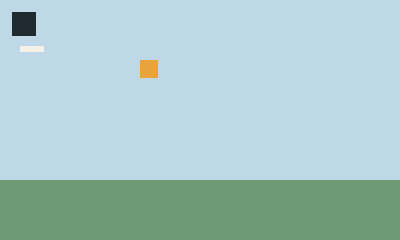

# 4. Palette and colour

NorthCel has one colour type: 8-bit RGB. You can write it three ways, and name it
once with `palette`.

## The three literal forms

| Form | Example | Notes |
| --- | --- | --- |
| hex | `#E8A33D`, `#EAD` | three or six hex digits |
| function | `rgb(232, 163, 61)` | integer channels `0..255` |
| greyscale | `tone: 14` | expands to `rgb(14, 14, 14)` |

Out-of-range channels are a validation error, not a clamp:
`Color channel r=300 out of range [0..255]`.

## `palette`

`palette` declares names before use. It accepts braces or parentheses and must
appear before the first `$name` reference — including references inside `def`
bodies, which are parsed when they are declared.

<!-- render: assets/guide/04-palette-chart.png -->
```ncel
northcel "0.2.0-draft"

scene PaletteChart(width: 400, height: 240, fps: 12, precision: 0.25px, seed: 5) {
  palette {
    ink: #202830,
    sky: #BFD8E8,
    sun: rgb(232, 163, 61),
    grass: #6E9A76,
    chalk: #F6F1E7,
  }
  paper { color: $chalk, antialias_grid: 4 }

  layer sky(color: $sky, rings: 1) { "0,0 1600,0 0,960 -1600,0" }
  layer sun(color: $sun, rings: 1) { "560,240 72,0 0,72 -72,0" }
  layer grass(color: $grass, rings: 1) { "0,720 1600,0 0,240 -1600,0" }
  layer ink_block(color: $ink, rings: 1) { "48,48 96,0 0,96 -96,0" }
  layer chalk_note(color: $chalk, rings: 1) { "80,184 96,0 0,24 -96,0" }
}
```



`$sky` is a colour value, not a string substitution: it carries the RGB it was
declared with. Changing the palette line changes every use.

## Scope

- A `palette` at the top of `scene`/`film` is visible for the rest of that body.
- A `palette` inside `frame k { ... }` is **local to that frame**. It can add or
  shadow a name; the inherited names remain visible.
- There is no palette inheritance between documents, and no palette import.
- `$name` is only for colours. Numbers, widths and positions are ordinary
  expressions and cannot be stored in a palette.

If two declarations use the same name, the later one wins from that point on.
Declaring a colour after a `def` that references it is an error, because the
`def` body is parsed where it is written.

## Defaults

When a layer, stroke or swarm omits `color`, it uses `tone: 14` (near-black); a
`cel`/`outline` without an explicit colour uses `$ink` if the palette declares it,
otherwise `#0D0D0D`. Naming your ink colour `ink` is therefore worth doing: it
makes `outline: 3px` do what you expect.

## What goes wrong

Referencing a name that was never declared (or declared later) stops the parse:

<!-- expect-error: 7:24: error: Undefined palette color '$blue' -->
```text
northcel "0.2.0-draft"

scene PaletteBad(width: 400, height: 240) {
  palette { ink: #202830, sky: #BFD8E8 }
  paper { color: #F6F1E7 }
  layer sky(color: $sky, rings: 1) { "0,0 1600,0 0,960 -1600,0" }
  layer accent(color: $blue, rings: 1) { "48,48 96,0 0,96 -96,0" }
}
```

```console
$ northcel check broken.ncel
broken.ncel:7:24: error: Undefined palette color '$blue'
```

Add `blue: #4C6FA5` to the palette above the layer, or write a literal colour.
Page [12](12-diagnostics-and-errors.md) explains why this is a parse error
rather than a warning.

Next: [5. Cels, layers and outlines](05-cels-layers-and-outlines.md).
