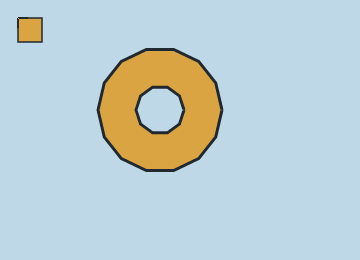

# 5. Cels, layers, washes and outlines

A `layer` is a filled contour. `wash` is the same statement under a painterly
name, and `cel` is the same fill with a coupled ink outline. All three take a
quoted contour payload and paint in document order.

## The statement

```text
layer name(color: #RRGGBB, rings: 1) { "ring payload" }
wash  name(tone: 190)               { "ring payload" }
cel   name(color: $fill, outline: ($ink, 3px)) { "ring payload" }
```

| Attribute | Meaning |
| --- | --- |
| `color:` / `fill:` | fill colour; `tone:` is the greyscale shorthand |
| `rings:` | optional declared ring count; a mismatch is a **warning**, not an error |
| `boil:` | per-vertex hand-drawn wobble (page [9](09-boil-and-seeded-variation.md)) |
| `translate:` | `(dx, dy)` expressions; moves the whole layer |
| `outline: (colour, Wpx)` | **(cel)** paint a closed ink stroke of width `W` on every ring |
| `outline: Wpx` | **(cel)** same, using `$ink` or `#0D0D0D` |
| `ink:` / `ink_width:` | older spelling of the same coupling |

`layer` and `wash` do not paint an outline unless you give them `outline:` —
which is legal, but then the statement is behaving like a `cel`. Use `cel` when
the fill and its boundary are one drawing decision.

## Even-odd rings and holes

A payload is one ring or several separated by `|`. Every ring is closed
implicitly and filled with the even-odd rule, so a ring inside another ring is a
hole, not a second fill.

<!-- render: assets/guide/05-cel-hole.png -->
```ncel
northcel "0.2.0-draft"

scene CelWithHole(width: 360, height: 260, fps: 12, precision: 0.25px, seed: 9) {
  palette { ink: #202830, brass: #D9A441, sky: #BFD8E8 }
  paper { color: #F6F1E7, antialias_grid: 4 }

  layer backplate(color: $sky, rings: 1) { "0,0 1440,0 0,1040 -1440,0" }
  cel ring(color: $brass, outline: ($ink, 3px), rings: 2) {
    "888,440 -25,108 -68,86 -100,48 -110,0 -100,-48 -68,-86 -25,-108 25,-108 68,-86 100,-48 110,0 100,48 68,86|736,440 -18,56 -48,35 -60,0 -48,-35 -18,-56 18,-56 48,-35 60,0 48,35"
  }
  cel badge(color: $brass, outline: 2px) { "72,72 96,0 0,96 -96,0" }
}
```



Two things are coupled here that are easy to get wrong separately:

- The hole is the second ring in the same payload. It is not a separate layer
  painted in the paper colour: you can see the sky through it.
- The `outline:` is stroked along **both** rings, so the hole gets an inner ink
  edge automatically. That is the reason `cel` exists; drawing a fill and a
  separate `stroke` for the same contour drifts apart as soon as either changes.

`rings: 2` is documentation. If it disagreed with the payload, `check` would
print a warning and render anyway.

## Paint order, not grouping

Each layer is a separate paint step. `cel ring` paints its fill and then its
outline before the next statement runs, so a later layer can cover the outline.
If you need an outline on top of everything, draw a separate `stroke` along the
same path (page [6](06-strokes-and-ribbons.md)).

## What goes wrong

A closed contour needs at least three vertices. A two-vertex ring is a line, not
an area, and is rejected during ring decoding:

<!-- expect-error: 4:3: error: Layer 'badge' has invalid ring payload: Ring 0: Decoded ring has only 2 vertices (< 3). -->
```ncel
northcel "0.2.0-draft"

scene RingBad(width: 360, height: 260) {
  cel badge(color: #E9B25B, outline: (#202830, 3px), rings: 1) { "120,120 160,0" }
}
```

```console
$ northcel check broken.ncel
broken.ncel:4:3: error: Layer 'badge' has invalid ring payload: Ring 0: Decoded ring has only 2 vertices (< 3).
```

If you wanted a line, use `stroke` (page [6](06-strokes-and-ribbons.md)). If you
wanted a thin rectangle, give it four corners. A malformed payload adds
`Expected 'dx,dy' pair at token N` or a Base-63 diagnostic inside the same
sentence; see [Common errors](../errors.md).

Next: [6. Strokes and ribbons](06-strokes-and-ribbons.md).
