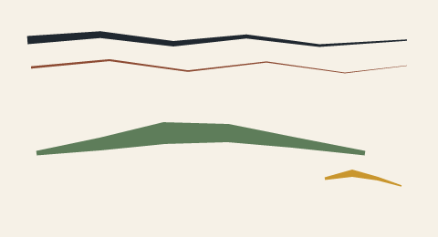

# 6. Strokes and ribbons

Layers are filled areas; ink is a path with width. NorthCel has two ink
statements: `stroke` (one width at the start, one at the end) and `ribbon` (a
width at every point).

## `stroke`

```text
stroke name(color: #RRGGBB, taper: (start_w, end_w), boil: 0.4px) {
  (x0, y0), (x1, y1), (x2, y2)
}
```

| Attribute | Default | Meaning |
| --- | --- | --- |
| `color:` / `tone:` | `tone: 14` | ink colour |
| `width: W` | `2.5` | constant width, if `taper` is absent |
| `taper: (w0, w1)` | — | width at the first and last control point; interpolated along the path |
| `boil:` | off | per-vertex wobble (page [9](09-boil-and-seeded-variation.md)) |

Points are ordinary expressions evaluated per frame, so `sin(t * 6.28318)` is
legal in a coordinate. At least two points are required. `stroke` has no
`translate:`; put the motion in the numbers.

## `ribbon`

```text
ribbon name(color: #RRGGBB, boil: 0.3px) {
  (x0, y0, w0), (x1, y1, w1), (x2, y2, w2)
}
```

Each point carries its own width. A ribbon is the right primitive for a brush
whose thickness changes with pressure — a lantern post, a cloth fold, a tapered
tail. Widths below `0.25` are clamped to `0.25` by the renderer; validation only
requires two points.

The path is polyline-interpolated, not spline-smoothed. Put more points where the
curve turns.

## A brush card

<!-- render: assets/guide/06-ink-card.png -->
```ncel
northcel "0.2.0-draft"

scene InkCard(width: 480, height: 260, fps: 12, precision: 0.25px, seed: 21) {
  palette { ink: #202830, rust: #8C4A32, moss: #5E7D5A, gold: #C9962E }
  paper { color: #F6F1E7, antialias_grid: 4 }

  stroke long_taper(color: $ink, taper: (9, 1.5)) {
    (30, 44), (110, 38), (190, 48), (270, 40), (350, 50), (446, 44)
  }
  stroke hairline(color: $rust, taper: (2.6, 0.5)) {
    (34, 74), (120, 66), (206, 78), (292, 68), (378, 80), (446, 72)
  }
  ribbon brush_body(color: $moss) {
    (40, 168, 5), (110, 158, 14), (180, 146, 24), (250, 146, 20), (320, 156, 12), (400, 168, 5)
  }
  ribbon tail(color: $gold) {
    (356, 196, 3), (386, 190, 8), (414, 196, 4), (440, 204, 1.5)
  }
}
```



The top two lines use `taper`; the two lower shapes use per-point ribbon widths.
The gold tail can end in a point because its last width is `1.5` pixels, not
because the geometry was tapered separately.

## How the polygon is built

Both statements expand the path into a closed polygon: offset the path by half
the local width on each side, then join the two sides and fill with the same
even-odd rasteriser as a layer. That is why ink and fills composite identically
and why a ribbon can self-overlap. There is no line-cap or line-join attribute;
ends are flat cuts of the offset polygon.

## What goes wrong

A single point has no direction, so no width can be applied:

<!-- expect-error: 4:3: error: Stroke 'dot' requires at least 2 control points -->
```ncel
northcel "0.2.0-draft"

scene StrokeBad(width: 480, height: 260) {
  stroke dot(color: #202830, width: 4px) { (40, 40) }
}
```

```console
$ northcel check broken.ncel
broken.ncel:4:3: error: Stroke 'dot' requires at least 2 control points
```

Use two points, even if they are close: `(40, 40), (41, 40)`. A dot is a tiny
`layer` or a short stroke. `width: 0` is likewise rejected with
`Stroke 'dot' widths must be > 0`; a ribbon with fewer than two `(x, y, w)`
points produces `Ribbon 'name' requires at least 2 (x, y, width) points`.

Next: [7. Definitions and parameters](07-def-use-and-parameters.md).
