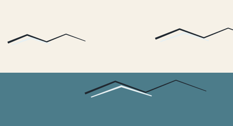

# 7. Definitions, `use` and parameters

A `def` names a group of primitives once. `use` paints that group at another
position, with different parameter values. It is the only form of reuse in the
language: there are no imports and no macros.

## The statements

```text
def Name(param: default, other: default) {
  layer child(...) { "..." }
  stroke mark(...) { (x + param, y), ... }
}

use Name(param: expression, other: expression)
```

- A `def` body accepts `layer`/`wash`/`cel`, `bend_swarm`/`swarm`, `stroke` and
  `ribbon`. It does **not** accept `use`, `drop`, `palette` or `paper`.
- Parameters are numbers with defaults. Missing arguments take the default.
- `use Name(...)` has no body. A trailing `;` is allowed.
- `dx` and `dy` are special: after expansion, the whole group is translated by
  them. Do not add `dx`/`dy` to the coordinates as well, or the group moves twice.
- Every other parameter is an ordinary name you use inside expressions.

## One definition, three placements

<!-- render: assets/guide/07-def-use.png -->
```ncel
northcel "0.2.0-draft"

scene DefinedMarks(width: 480, height: 260, fps: 12, precision: 0.25px, seed: 31) {
  palette { ink: #202830, sea: #4C7C8A, foam: #E7F0F2 }
  paper { color: #F6F1E7, antialias_grid: 4 }

  def Wave(dx: 0, dy: 0, scale: 1) {
    stroke crest(color: $ink, taper: (4, 1.2)) {
      (20 * scale, 60 * scale), (70 * scale, 40 * scale), (120 * scale, 58 * scale),
      (170 * scale, 38 * scale), (220 * scale, 56 * scale)
    }
    ribbon foam(color: $foam) {
      (30 * scale, 66 * scale, 2), (80 * scale, 48 * scale, 4), (130 * scale, 64 * scale, 2)
    }
  }

  layer sea(color: $sea, rings: 1) { "0,600 1920,0 0,440 -1920,0" }
  use Wave(dx: 0, dy: 40, scale: 0.8)
  use Wave(dx: 150, dy: 118, scale: 1.25)
  use Wave(dx: 300, dy: 20, scale: 1)
}
```



Only the `use` lines changed between the three waves. `dx`/`dy` translated each
expanded group; `scale` fed the expressions inside; the colours came from the
palette. This is the cheapest way to author a repeated motif — a hand, a grass
tuft, a bird, a cloud — without copying coordinates.

## Reuse has a name rule

Expansion happens into one flat paint list. If two `use` blocks expand a **layer
or cel with the same name**, the second replaces the first in its original paint
position rather than adding a second shape. Strokes and ribbons append. That is
the same in-place replacement rule that `frame` overrides use (page
[8](08-films-and-frame-overrides.md)).

For repeated independent filled shapes, give each `def` its own name (or put the
fill in a `stroke`/`ribbon`). For repeated ink only — the typical wave, grass or
bird — a single def used many times is exactly right.

## Parameters are evaluated at the call site

`use Wave(dx: sin(t * 6.28318) * 20)` is legal in a film: arguments are evaluated
per frame, and a parameter can depend on `t`, `f`, `seed` and other parameters.

One limit is worth knowing early: **attributes are evaluated when the file is
parsed, not per frame**. A parameter can be used in point coordinates and in
`translate:`, but not in `taper:`, `width:`, `color:`, `tone:` or a ring payload.
Those are constants of the document. The example above scales the path points and
keeps the ink widths fixed, which is also what a brush does when the shape gets
larger.

`def` bodies may not reference a `$palette` name declared after them. Declare the
palette first (page [4](04-palette-and-colour.md)).

## What goes wrong

`use` must name a def declared in the same scene, film or frame body:

<!-- expect-error: 4:3: error: Use of undefined def block 'Wave' -->
```text
northcel "0.2.0-draft"

scene UseBad(width: 480, height: 260) {
  use Wave(dx: 10, dy: 0)
}
```

```console
$ northcel check broken.ncel
broken.ncel:4:3: error: Use of undefined def block 'Wave'
```

Declare `def Wave(...) { ... }` before the use. A `def` that exists only in
`frame k { ... }` is not visible outside that frame; defs are resolved with the
body in which the `use` appears.

Next: [8. Films, frame overrides and `drop`](08-films-and-frame-overrides.md).
