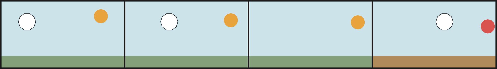

# 8. Films, frame overrides and `drop`

A `film` is a timeline. Every frame is a pure function of the document, the frame
index and the seed — there is no state carried from frame to frame.

## The header

```text
film Name(width: 480, height: 260, fps: 12, frames: 6, precision: 0.25px, seed: 12) {
  ...
}
```

| Attribute | Meaning |
| --- | --- |
| `frames` | number of frames, `>= 1`; duration is `frames / fps` |
| `fps` | playback rate used for timing and the optional MP4 |
| `t` | inside expressions: `f / max(1, frames - 1)`, so `0.0` … `1.0` |
| `f` | the zero-based frame index as a number |

`frames` must be in the header. Putting `frames: 6` in the body produces
`Unknown film statement 'frames'` (page [1](01-getting-started.md)).

## Motion without keyframes

A film is not a keyframe timeline. You express motion by making a coordinate,
colour or width an expression of `t` (or `f`). `lerp(a, b, t)` gives a straight
interpolation, `sin`/`cos` give cycles, and `step(edge, x)` gives a hard switch.

<!-- render: assets/guide/08-two-beats.png frames=0,2,3,5 -->
```ncel
northcel "0.2.0-draft"

film TwoBeats(width: 480, height: 260, fps: 12, frames: 6, precision: 0.25px, seed: 12) {
  palette { ink: #202830, sky: #CDE3EA, sun: #E8A33D, cloud: #FFFFFF }
  paper { color: #F6F1E7, antialias_grid: 4 }

  layer sky(color: $sky, rings: 1) { "0,0 1920,0 0,1040 -1920,0" }
  layer sun(color: $sun, rings: 1, translate: (lerp(0, 60, t), lerp(0, 40, t))) {
    "1672,232 -15,56 -41,41 -56,15 -56,-15 -41,-41 -15,-56 15,-56 41,-41 56,-15 56,15 41,41"
  }
  cel cloud(color: $cloud, outline: ($ink, 2px), translate: (lerp(0, 180, t), 0)) {
    "536,320 -26,80 -68,49 -84,0 -68,-49 -26,-80 26,-80 68,-49 84,0 68,49"
  }
  layer ground(color: #83A07B, rings: 1) { "0,860 1920,0 0,180 -1920,0" }

  frame 3 { drop cloud }
  frame 5 {
    layer sun(color: #D9534F, rings: 1, translate: (60, 40)) {
      "1672,232 -15,56 -41,41 -56,15 -56,-15 -41,-41 -15,-56 15,-56 41,-41 56,-15 56,15 41,41"
    }
    layer ground(color: #B08A5A, rings: 1) { "0,860 1920,0 0,180 -1920,0" }
  }
}
```



Read the sheet left to right:

- frame 0: sun at the start of its arc, cloud at the left;
- frame 2: both have moved (`translate` expressions), cloud still present;
- frame 3: `drop cloud` — the cloud is absent, the rest is unchanged;
- frame 5: the `frame 5` override replaced `sun` with a red one and `ground` with
  a dusk colour, in their original paint positions.

## `frame k { ... }`

An override affects **exactly frame `k`**, not frame `k` and everything after.
Declaring a `layer`, `cel` or `wash` with an inherited name replaces that layer at
its original paint position. `stroke` and `ribbon` do not replace: they append,
which leaves the inherited ink visible too. `drop name` removes the named layer
and any coupled `outline` for that one frame.

A frame override may also declare a local `palette`, `paper`, `def` and `use`.
Palette additions are local to that frame; `paper` replaces the background for
that frame.

This is the surgical-edit mechanism: to change one beat, you add or edit one
`frame k` block and leave the base timeline alone (page
[14](14-editing-one-frame.md)).

## What goes wrong

The override index must be a real frame. Shortening a film without updating its
overrides is the usual cause:

<!-- expect-error: 6:3: error: Frame override index 9 out of range [0..5] -->
```ncel
northcel "0.2.0-draft"

film BadFrame(width: 480, height: 260, frames: 6) {
  paper { color: #F6F1E7 }
  layer sky(color: #CDE3EA, rings: 1) { "0,0 1920,0 0,1040 -1920,0" }
  frame 9 { drop sky }
}
```

```console
$ northcel check broken.ncel
broken.ncel:6:3: error: Frame override index 9 out of range [0..5]
```

With `frames: 6` the valid indices are `0..5`. Either raise `frames` or delete
the unreachable override. The range in the message is inclusive and always refers
to the current header, not to the file's history.

Next: [9. Boil and seeded variation](09-boil-and-seeded-variation.md).
