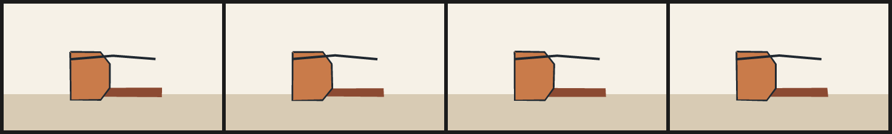

# 9. Boil and seeded variation

Hand-drawn animation is never perfectly still. Lines wobble from drawing to
drawing even when nothing in the scene moved. NorthCel calls that **boil**, and it
is the only source of variation in the language besides the seed.

## The attribute

```text
layer name(..., boil: 0.6px) { "..." }
cel   name(..., boil: 0.6px) { "..." }
stroke name(..., boil: 0.4px) { ... }
ribbon name(..., boil: 0.3px) { ... }
bend_swarm name(..., boil: 0.5px) { "..." }
```

- `boil: 0.6px` sets the amplitude; frequency is `1.0` (a new pattern each frame).
- `boil: (0.6, 0.5)` sets amplitude and frequency. A frequency below `1.0` holds
  the same wobble for several frames, which reads as a slower "boil".
- Amplitude is in pixels. `0` or absence means no wobble.

There is no RNG and no cross-frame state. Each vertex offset is a pure 32-bit hash
of `(seed, frame index, item index, ring index, vertex index)`. That means:

- rendering frame 3 alone gives exactly the pixels of frame 3 in a full film;
- rendering the frames in any order gives the same result;
- two machines give the same wobble;
- changing `seed` changes the whole pattern, without touching the drawing.

## A boil study

<!-- render: assets/guide/09-boil-study.png frames=0,1,2,3 -->
```ncel
northcel "0.2.0-draft"

film BoilStudy(width: 360, height: 210, fps: 8, frames: 4, precision: 0.25px, seed: 77) {
  palette { ink: #202830, clay: #C97B4A, shade: #8C4A32 }
  paper { color: #F6F1E7, antialias_grid: 4 }

  layer table(color: #D8CBB4, rings: 1) { "0,600 1440,0 0,240 -1440,0" }
  layer pot_shadow(color: $shade, rings: 1, boil: 1px) { "560,560 480,0 0,56 -480,0" }
  cel pot(color: $clay, outline: ($ink, 3px), boil: 0.7px) {
    "440,320 200,0 60,80 0,160 -60,80 -200,0"
  }
  stroke rim(color: $ink, taper: (4, 4), boil: 0.4px) {
    (110, 92), (180, 86), (250, 92)
  }
}
```



Nothing moves between these four frames except the boil: the pot's contour, its
outline, the shadow and the rim line all shift by a fraction of a pixel. The
silhouette stays readable, which is the point — boil should suggest a hand, not a
seizure.

## Choosing an amplitude

| Amplitude | Reads as |
| --- | --- |
| `0.1–0.3px` | almost invisible; useful for clean digital ink |
| `0.3–0.7px` | a line drawn with a pencil or a brush on paper (the usual choice) |
| `0.8–1.5px` | visible "boiling line" animation, closer to charcoal or rough ink |
| `> 2px` | the shape itself starts to deform; use deliberately, or move the vertices |

Frequency is a taste control: `1.0` is a fresh wobble per frame (busy at 24 fps),
`0.5` holds it for two frames, `0.25` for four.

## What goes wrong

Numbers in NorthCel may be unitless or carry `px`/`px-b63`/`deg`, but they must
start with a digit. A leading dot is not accepted:

<!-- expect-error: 4:51: error: Unexpected character '.' -->
```text
northcel "0.2.0-draft"

scene BoilBad(width: 360, height: 210) {
  stroke wobble(color: #202830, width: 4px, boil: .5px) {
    (40, 90), (120, 70), (200, 100), (280, 80)
  }
}
```

```console
$ northcel check broken.ncel
broken.ncel:4:51: error: Unexpected character '.'
```

Write `0.5px`. The tokenizer reports the exact column of the character it could
not start a token with, which makes this class of typo quick to fix.

Next: [10. Contour encodings](10-contour-encodings.md).
