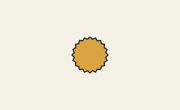

# 10. Contour encodings and when to use which

Every filled shape is a ring. Rings are stored as **relative integer deltas**,
not absolute vertices, because that is what makes a traced contour small. The
header `precision:` selects how those integers are written.

There are two encodings and three precision values:

| `precision:` | First vertex | Each step | Accuracy | Size |
| --- | --- | --- | --- | --- |
| `0.25px` | `qx,qy` (pixels × 4) | `dqx,dqy` as integer text pairs | quarter pixel | largest, most readable |
| `0.25px-b63` | `qx,qy` | two Base-63 characters per step | quarter pixel | compact |
| `1px` | `x,y` (whole pixels) | two Base-63 characters per step | whole pixel | smallest |

## Plain quarter-pixel text (`0.25px`)

```text
"x0*4,y0*4  dx1,dy1  dx2,dy2  ..."
```

Write the first vertex multiplied by four, then each following vertex as a delta
from the previous one, also multiplied by four. The ring closes implicitly from
the last vertex back to the first. `|` separates rings (even-odd holes). This is
the encoding to hand-write: every number is a whole quarter pixel and you can
check the arithmetic in your head.

## Base-63 (`0.25px-b63` and `1px`)

```text
"x0,y0:ABCDEF..."
```

The start is plain text. Every following character pair is a delta, mapped through
the 63-character alphabet:

```text
0123456789ABCDEFGHIJKLMNOPQRSTUVWXYZabcdefghijklmnopqrstuvwxyz_
```

Character index `i` encodes `i - 31`, so the deltas run `-31..+31`. A segment
longer than 31 units is stored as several collinear steps (the encoder splits
it); the polygon is the same, but it has more vertices than the plain encoding. With `1px`, the start
and deltas are whole pixels; with `0.25px-b63` they are quarter pixels.

The `1px` mode is the right choice when a traced frame must fit a hard token
budget and half-pixel edge placement is not worth the bytes. The
[examples table](../examples.md) has the measured size/SSIM trade-off.

## The same badge, both ways

Both files below draw the same 40-point badge at the same seed. The images are
pixel-identical; only the payload differs.

<!-- render: assets/guide/10-quarter-text.png -->
```ncel
northcel "0.2.0-draft"

scene BadgeQuarter(width: 360, height: 220, fps: 12, precision: 0.25px, seed: 4) {
  palette { ink: #202830, gold: #D9A441 }
  paper { color: #F6F1E7, antialias_grid: 4 }
  cel badge(color: $gold, outline: ($ink, 3px), rings: 1) {
    "720,296 20,18 24,-11 14,23 27,-2 6,25 25,6 -2,27 23,14 -11,24 18,20 -18,20 11,24 -23,14 2,27 -25,6 -6,25 -27,-2 -14,23 -24,-11 -20,18 -20,-18 -24,11 -14,-23 -27,2 -6,-25 -25,-6 2,-27 -23,-14 11,-24 -18,-20 18,-20 -11,-24 23,-14 -2,-27 25,-6 6,-25 27,2 14,-23 24,11"
  }
}
```


<!-- render: assets/guide/10-base63.png -->
```ncel
northcel "0.2.0-draft"

scene BadgeBase63(width: 360, height: 220, fps: 12, precision: 0.25px-b63, seed: 4) {
  palette { ink: #202830, gold: #D9A441 }
  paper { color: #F6F1E7, antialias_grid: 4 }
  cel badge(color: $gold, outline: ($ink, 3px), rings: 1) {
    "720,296:pntKjswTbuubTwsjKtnpDpgt8jXw6bPu4THs7KBnBD7gH84XP66PX48Hg7DBnBK7sHT4uPb6wXj8tg"
  }
}
```



The same badge in both encodings:

| File | Payload characters | File bytes | Pixels |
| --- | ---: | ---: | --- |
| `precision: 0.25px` | 264 | 525 | reference |
| `precision: 0.25px-b63` | 86 | 350 | **0 pixels differ** |

The Base-63 payload is 67% shorter here because every step fits in one
two-character pair. If a segment is longer than 31 quarter pixels, the encoder
subdivides it into several collinear steps; that keeps the shape but adds
vertices, which is why a fitted traced frame can still differ by a handful of
edge pixels from a plain payload. Keep hand-authored segments short if you care
about exact agreement.

## Which should you write?

| Situation | Use |
| --- | --- |
| you are typing coordinates by hand or with an AI agent | `0.25px` |
| a contour was fitted from an image and is mostly long edges | `0.25px-b63` |
| the file must be as small as possible and whole-pixel edges are acceptable | `1px` |
| you want to read a file months later | `0.25px` |

There is no way to mix encodings inside one document: `precision:` is a property
of the root container and applies to every layer, stroke and swarm payload.

## What goes wrong

A Base-63 tail is a sequence of **pairs**. An odd number of characters cannot be
split into deltas:

<!-- expect-error: 4:3: error: Layer 'badge' has invalid ring payload: Ring 0: Base-63 delta tail must have an even number of characters. -->
```text
northcel "0.2.0-draft"

scene B63Bad(width: 360, height: 220, precision: 0.25px-b63) {
  layer badge(color: #D9A441, rings: 1) { "720,440:lxlxl" }
}
```

```console
$ northcel check broken.ncel
broken.ncel:4:3: error: Layer 'badge' has invalid ring payload: Ring 0: Base-63 delta tail must have an even number of characters.
```

Other payload diagnostics in the same family: `Base-63 ring string must contain
':' after 'x0,y0'`, `Invalid Base-63 character pair 'Xy' at offset N`, and
`Decoded Base-63 ring has only N vertices (< 3)`. All are listed with causes in
[Common errors](../errors.md).

Next: [11. `bend_swarm`](11-bend-swarm.md).
