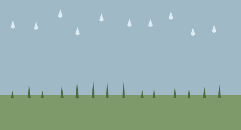

# 11. `bend_swarm`: many small marks

A `bend_swarm` (short spelling `swarm`) is a bag of small rings evaluated
together. It exists for detail that is repetitive and independent: rain, grass,
bristles, stars, dust, fish in a school.

## The statement

```text
bend_swarm name(agents: 12, color: #RRGGBB, boil: 0.4px, translate: (dx, dy)) {
  "ring1|ring2|...|ringN"
}
```

| Attribute | Meaning |
| --- | --- |
| `agents:` | the declared number of agents, `>= 1` |
| `color:` / `tone:` | one colour for the whole swarm |
| `boil:` | per-vertex wobble (page [9](09-boil-and-seeded-variation.md)) |
| `translate:` | moves every agent by the same `(dx, dy)` |

**One `|`-separated ring is one agent.** `agents:` is a declaration, not a
multiplier: writing `agents: 8` over a payload of one ring draws one ring, not
eight. Put as many rings in the payload as you want marks, and declare the same
number in `agents:` so the file says what it means. The validator requires
`agents >= 1` and at least one decoded ring; it does not compare the two counts
today.

## Why a swarm instead of many layers

Every ring in a swarm is an independent agent with no ordering between them. The
native runtime evaluates them with Bend/HVM2 and validates the agent, ring and
vertex counts before drawing; the reference renderer decodes the same payload and
paints it with the same even-odd rasteriser. The practical benefits are a much
smaller file (one statement, one colour, one boilerplate) and a clean unit for
agentic editing: changing the rain means editing one swarm, not twenty layers.

<!-- render: assets/guide/11-rain-and-grass.png -->
```ncel
northcel "0.2.0-draft"

scene SwarmField(width: 480, height: 260, fps: 12, precision: 0.25px, seed: 64) {
  palette { ink: #202830, sky: #9FB9C6, rain: #DCEBF2, grass: #4F6B45 }
  paper { color: #F6F1E7, antialias_grid: 4 }

  layer sky(color: $sky, rings: 1) { "0,0 1920,0 0,900 -1920,0" }
  layer ground(color: #7E9A6A, rings: 1) { "0,760 1920,0 0,280 -1920,0" }

  bend_swarm rain(agents: 10, color: $rain, boil: 0.3px) {
    "103,162 18,56 -18,12 -18,-12|288,173 18,56 -18,12 -18,-12|480,76 18,56 -18,12 -18,-12|617,215 18,56 -18,12 -18,-12|809,106 18,56 -18,12 -18,-12|1032,149 18,56 -18,12 -18,-12|1198,150 18,56 -18,12 -18,-12|1361,91 18,56 -18,12 -18,-12|1537,220 18,56 -18,12 -18,-12|1705,197 18,56 -18,12 -18,-12"
  }
  bend_swarm grass(agents: 14, color: $grass, boil: 0.5px) {
    "88,784 12,-62 12,62|220,784 12,-108 12,108|326,784 12,-59 12,59|482,784 12,-98 12,98|603,784 12,-133 12,133|730,784 12,-137 12,137|843,784 12,-126 12,126|973,784 12,-138 12,138|1122,784 12,-65 12,65|1215,784 12,-75 12,75|1382,784 12,-94 12,94|1494,784 12,-82 12,82|1616,784 12,-90 12,90|1737,784 12,-107 12,107"
  }
}
```



Both swarms paint in document order like any other statement. The rain is over
the sky and the ground; the grass is over the ground because it is written after
it. The two swarms have different `boil` amplitudes and share the scene seed.

## Editing a swarm

- To change one mark, change one ring inside the payload; the other rings are
  untouched (the surgical-edit rule).
- To move the whole swarm, add `translate:`; do not rewrite every ring.
- To change density, add or remove rings and update `agents:` to match.
- To change the look, change the one `color:`.

Because all agents share the statement's `boil` and `translate`, a swarm is not a
good container for marks that need different motion. Use two swarms, or
`def`/`use` with separate strokes (page [7](07-def-use-and-parameters.md)).

## What goes wrong

A swarm with no agents is rejected before rendering:

<!-- expect-error: 4:3: error: Swarm 'rain' must have agents >= 1 (got 0) -->
```ncel
northcel "0.2.0-draft"

scene SwarmBad(width: 480, height: 260) {
  bend_swarm rain(agents: 0, color: #DCEBF2) {
    "103,162 18,56 -18,12 -18,-12"
  }
}
```

```console
$ northcel check broken.ncel
broken.ncel:4:3: error: Swarm 'rain' must have agents >= 1 (got 0)
```

A payload that decodes to no rings gives `Swarm 'rain' payload decoded to 0
rings`. Neither message says anything about artistic density: `agents: 1` with
one ring is legal, and a hundred rings with `agents: 1` also renders today. Keep
the declaration honest so the next reader (or agent) knows what the payload is.

Next: [12. Diagnostics and errors](12-diagnostics-and-errors.md).
