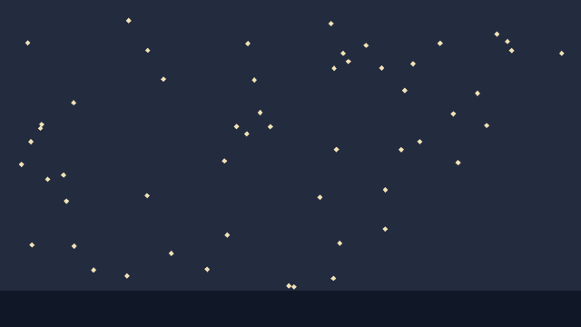

# 13. Performance and limits

NorthCel is CPU-only. The native runtime opens a headless Mesa/EGL context and
rasterises with llvmpipe; the reference renderer does the same arithmetic in
NumPy. A GPU is not required and is not used.

## What is measured

These are wall-clock timings for the native runtime and the Python reference on
the same machine (Ubuntu 24.04, x86_64, Mesa 25.2.8 llvmpipe, 1 vCPU), not a
benchmark score.

| Case | Native | Reference |
| --- | ---: | ---: |
| shower still, 1024×1024, 2 swarms | 0.85 s | 0.62 s |
| a 1536×864 colour frame, 8 cels | 0.69 s | 1.13 s |
| the whole 90-frame fitted film, 1536×864 | 56.1 s | — |

Peak memory was 140 MB (native) and 78 MB (reference) on the shower still;
150 MB / 190 MB on the 1536×864 framed. Stage split for the shower frame: Bend
0.20 s, MoonBit IR 0.019 s, GLSL 0.657 s.

The reference renderer draws the 640×360 star field below in about 0.4 s per
frame (three runs: 0.35–0.39 s for the 60-agent scene). Treat that as an order of
magnitude for a laptop-class CPU, not a promise.

## The knobs that matter

| Knob | Effect |
| --- | --- |
| `width × height` | cost is roughly linear in pixels |
| `antialias_grid` | `8` does four times the subpixel work of `4`; `1` is fastest and jagged |
| number of rings / vertices | the dominant cost for traced scenes |
| `bend_swarm` agents | one agent per ring; splitting into many small swarms does not make them cheaper |
| `boil` | negligible; it is one hash per vertex per frame |
| `film` frames | linear; each frame is independent |

The render of one frame is independent of every other frame, so a film can be
rendered in any order and split across processes. The CLI does the simple thing:
one process, frames in sequence.

## A 60-agent star field

<!-- render: assets/guide/13-star-field.png -->
```ncel
northcel "0.2.0-draft"

scene StarField(width: 640, height: 360, fps: 12, precision: 0.25px, seed: 9) {
  palette { ink: #1B2436, night: #232B3F, star: #F2E3B6 }
  paper { color: #F6F1E7, antialias_grid: 4 }

  layer sky(color: $night, rings: 1) { "0,0 2560,0 0,1440 -2560,0" }
  bend_swarm stars(agents: 60, color: $star, boil: 0.25px) {
    "1191,546 12,12 -12,12 -12,-12|412,1177 12,12 -12,12 -12,-12|95,712 12,12 -12,12 -12,-12|2236,171 12,12 -12,12 -12,-12|1410,857 12,12 -12,12 -12,-12|178,553 12,12 -12,12 -12,-12|1768,647 12,12 -12,12 -12,-12|1820,269 12,12 -12,12 -12,-12|651,210 12,12 -12,12 -12,-12|1295,1251 12,12 -12,12 -12,-12|1497,1059 12,12 -12,12 -12,-12|1001,1023 12,12 -12,12 -12,-12|324,441 12,12 -12,12 -12,-12|1698,997 12,12 -12,12 -12,-12|1092,180 12,12 -12,12 -12,-12|720,337 12,12 -12,12 -12,-12|755,1104 12,12 -12,12 -12,-12|559,1203 12,12 -12,12 -12,-12|2190,138 12,12 -12,12 -12,-12|989,697 12,12 -12,12 -12,-12|136,612 12,12 -12,12 -12,-12|2255,211 12,12 -12,12 -12,-12|1512,223 12,12 -12,12 -12,-12|1469,1214 12,12 -12,12 -12,-12|567,79 12,12 -12,12 -12,-12|280,759 12,12 -12,12 -12,-12|122,177 12,12 -12,12 -12,-12|1272,1247 12,12 -12,12 -12,-12|1088,578 12,12 -12,12 -12,-12|1613,188 12,12 -12,12 -12,-12|1472,289 12,12 -12,12 -12,-12|1541,1295 12,12 -12,12 -12,-12|210,778 12,12 -12,12 -12,-12|1535,259 12,12 -12,12 -12,-12|724,1341 12,12 -12,12 -12,-12|2475,223 12,12 -12,12 -12,-12|1773,1285 12,12 -12,12 -12,-12|648,850 12,12 -12,12 -12,-12|183,536 12,12 -12,12 -12,-12|1698,824 12,12 -12,12 -12,-12|1939,179 12,12 -12,12 -12,-12|913,1174 12,12 -12,12 -12,-12|1482,646 12,12 -12,12 -12,-12|1045,1330 12,12 -12,12 -12,-12|1459,92 12,12 -12,12 -12,-12|1998,489 12,12 -12,12 -12,-12|1121,341 12,12 -12,12 -12,-12|1146,484 12,12 -12,12 -12,-12|293,874 12,12 -12,12 -12,-12|327,1072 12,12 -12,12 -12,-12|141,1067 12,12 -12,12 -12,-12|2018,705 12,12 -12,12 -12,-12|1783,386 12,12 -12,12 -12,-12|1850,612 12,12 -12,12 -12,-12|634,1302 12,12 -12,12 -12,-12|1042,545 12,12 -12,12 -12,-12|2144,541 12,12 -12,12 -12,-12|1682,287 12,12 -12,12 -12,-12|2104,399 12,12 -12,12 -12,-12|201,1316 12,12 -12,12 -12,-12"
  }
  layer ground(color: #101726, rings: 1) { "0,1280 2560,0 0,160 -2560,0" }
}
```



## Hard limits

| Limit | Value | Where it comes from |
| --- | --- | --- |
| canvas | `1..8192` per side | validation |
| fps | `1..240` | validation |
| film frames | `>= 1`, no upper bound | validation (memory is yours) |
| swarm agents | `>= 1` | validation |
| stroke points | `>= 2` | validation |
| ring vertices | `>= 3` | ring decoder |
| HVM per-definition nodes | 4095 | Bend/HVM2 codegen in the native runtime |
| GL | OpenGL 4.5 core, GLSL 4.30 | native host (4.10 shader fallback compiles here) |

The 4095-node limit is a property of the generated Bend program: one dispatch
function with inline agent bodies. A single frame with enormously many agents or
vertices would need chunking; nothing in this guide approaches it.

## Platform matrix

| Platform | Native | What actually happens |
| --- | --- | --- |
| Linux x86_64, glibc ≥ 2.39, Mesa/EGL | **verified** | MoonBit + Bend/HVM2 + GLSL on llvmpipe |
| Linux x86_64, GPU GL | untested | likely works, not claimed |
| Linux x86_64, older glibc | no | the pinned Bend/HVM need `GLIBC_2.39`; the launcher says so |
| Linux aarch64 | no | launcher only; reference can render |
| macOS | no | Apple's GL stops at 4.1; needs Vulkan/MoltenVK or a tested GL 4.1 path. `doctor` exits `3` |
| Windows | no | same; reference renderer only |

On every platform without a native bundle, the CLI prints one line and labels
the renderer `python-reference`. That is honest, and it works: the reference is
the normative oracle. It is not the native runtime and must never be presented as
such.

## Determinism, measured

Every frame is a pure function of `(document, frame index, seed)`. Forward and
shuffled frame order produce identical sha256 hashes for all six lantern frames,
repeated renders produce identical bytes, and Mesa thread counts 1/2/4/8 produce
one unique hash. Across 296 frames and ~388 M pixels, native and reference differ
on **52 pixels**, worst per-frame grey MAE 2.06e-4, worst block SSIM 0.99999931.
The cause is float32 edge upload versus float64 crossings, not geometry. A handful
of pixels is what "the two implementations agree" means in practice; the docs
check uses the reference renderer so its committed hashes do not depend on a host
Mesa version.

## What goes wrong

A canvas side above 8192 is rejected before allocation:

<!-- expect-error: 3:1: error: Canvas dimensions 9000x360 out of valid range [1..8192] -->
```ncel
northcel "0.2.0-draft"

scene TooWide(width: 9000, height: 360) {
  paper { color: #F6F1E7 }
}
```

```console
$ northcel check broken.ncel
broken.ncel:3:1: error: Canvas dimensions 9000x360 out of valid range [1..8192]
```

Render tiles and compose them outside NorthCel, or work at a sane size and scale the final image.
The same check rejects `fps: 0` / `fps: 241`.

Next: [14. Editing one frame surgically](14-editing-one-frame.md).
