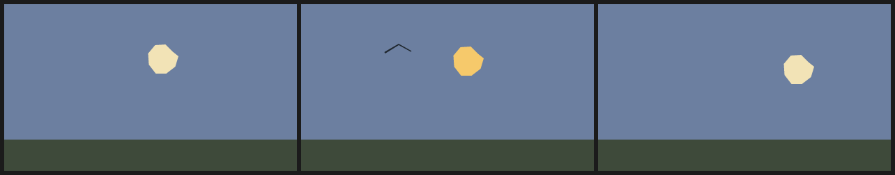

# 14. Editing one frame surgically

The point of a drawing language is that a small change stays small. This page is
the recipe for changing one frame without redoing the film.

## The rule

Everything outside a `frame k { ... }` block is the base timeline. A frame
override is a delta applied to exactly frame `k`:

- declaring a `layer`/`cel`/`wash` with an inherited name replaces it in place;
- `drop name` removes it for that frame;
- a new `stroke`/`ribbon` appends for that frame;
- `paper` and `palette` can be overridden for that frame.

So the edit is: find the frame index, add or change one block, render that frame,
and check its neighbours. You never touch the other frames.

## Base film, one edited beat

The film below is a five-frame dusk shot. Frame 3 is the only edited beat: the
moon turns warmer and a bird enters for that frame.

<!-- render: assets/guide/14-one-beat.png frames=2,3,4 -->
```ncel
northcel "0.2.0-draft"

film OneBeatEdit(width: 420, height: 240, fps: 10, frames: 5, precision: 0.25px, seed: 55) {
  palette { ink: #202830, dusk: #6C7FA0, moon: #F2E3B6, bird: #202830 }
  paper { color: #F6F1E7, antialias_grid: 4 }

  layer sky(color: $dusk, rings: 1) { "0,0 1680,0 0,960 -1680,0" }
  layer moon(color: $moon, rings: 1, translate: (lerp(0, 120, t), lerp(0, 30, t))) {
    "760,240 -18,60 -52,40 -60,0 -40,-52 -4,-64 40,-48 60,-4 44,44"
  }
  layer hill(color: #3E4A3A, rings: 1) { "0,780 1680,0 0,180 -1680,0" }

  frame 3 {
    layer moon(color: #F6C96B, rings: 1, translate: (72, 18)) {
      "760,240 -18,60 -52,40 -60,0 -40,-52 -4,-64 40,-48 60,-4 44,44"
    }
    stroke bird(color: $bird, taper: (2.5, 1.5)) {
      (120, 70), (140, 58), (158, 68)
    }
  }
}
```



Frames 2 and 4 are untouched. The moon still follows its base `translate`
expression there; frame 3 uses the replacement's own translate. The bird is a
stroke declared only in the override, so it appends for one frame and disappears.

## The edit loop

```console
$ northcel render film.ncel -o before.png --frame 2
$ northcel render film.ncel -o edited.png --frame 3
$ northcel render film.ncel -o after.png  --frame 4
```

Three stills are enough for a one-frame edit: the edited frame and both
neighbours. If the change is meant to persist, it belongs in the base timeline
instead (or in every override you want it in). If it is a colour beat, this is
exactly the right shape.

For a whole-film change, edit the base block once. For a per-frame change, do not
copy the whole scene into `frame k`; declare only the named layer that changes.
An override can be as small as `frame 3 { drop cloud }`.

## What goes wrong

The most common surgical-edit mistake is shortening the film later and leaving an
override behind. The parser accepts it; validation rejects it:

<!-- expect-error: 6:3: error: Frame override index 5 out of range [0..3] -->
```ncel
northcel "0.2.0-draft"

film Shortened(width: 420, height: 240, frames: 4) {
  paper { color: #F6F1E7 }
  layer sky(color: #6C7FA0, rings: 1) { "0,0 1680,0 0,960 -1680,0" }
  frame 5 { drop sky }
}
```

```console
$ northcel check broken.ncel
broken.ncel:6:3: error: Frame override index 5 out of range [0..3]
```

Either restore `frames: 6`, or delete the override that no longer has a frame.
The same happens when an override is copied from another file: the index is
local to the film.

## Verify the edit, not just the file

`check` proves the override is legal. It does not prove it looks right. Render the
edited frame and both neighbours; the docs check in this repository renders every
snippet and every pattern and compares the pixels, which is the same discipline
at a larger scale.

Next: [back to the guide index](README.md) · [Patterns](../patterns/README.md) ·
[Common errors](../errors.md).
