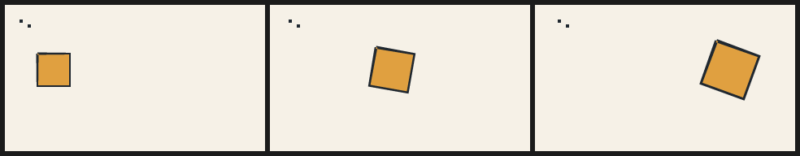

# 15. Fit a drawing, move it intact, inspect the in-betweens

Tools 0.4.0 implements spec [0.3.0-draft](../spec/SPEC-0.3.0-draft.md).
Older 0.2 programs keep their pixels. This chapter adds no rig and no image model:
it moves an existing drawing without changing its wardrobe or inventing a pose.

## Fit is an authoring tool, not an image input to the renderer

```console
$ pip install 'northcel[fit]'
$ northcel fit drawing.png -o drawing.ncel --colors 128 --cell-edges --tolerance 0.05 --min-area 0 --receipt fit.json
$ northcel render drawing.ncel -o roundtrip.png
```

The optional numerical dependencies quantise colours and trace closed contours.
The `.ncel` contains only a palette and vector chains: no bitmap, image path or
per-pixel lookup table. The input can be deleted and the file still renders.
`--palette colours.json` supplies `[[r,g,b], ...]` for a sequence-wide palette;
`--mask matte.png` supplies an **author-chosen** nonzero matte for one intact cel.
The fitter never chooses the subject, diagnoses motion or accepts its own result.

`--cell-edges` restores the orthogonal boundary of each colour region instead of
cutting pixel-cell corners into marching-squares diamonds. It matters for pencil
texture, but the price is much larger source. Plain `fit` defaults to 32 colours,
0.6px simplification and 2px² minimum contour area: compact, **not lossless**.
Fitting receipts report these choices, total geometry bytes and `quality:
"unreviewed"`. Compare the rendered pixels to the input, including small coloured
regions; a sky-dominated palette can discard the face colour.

Keep the fitted file's declared `paper` when composing scenes; receipts also name
`underpaint_rgb`. Near-white paper may be #FEFEFE, not #FFFFFF. With all 256 grey
levels, cell edges and zero area filtering, the monochrome conformance test keeps
every RGB byte; throwing away its underpaint would silently change most pixels.

## Immediate transforms

```text
transform badge(scale: 1.2, rotate: 15deg, anchor: (160, 90), translate: (10, 0))
transform all(scale: (1, -1), anchor: (160, 90))
```

`transform badge` changes geometry already painted under that name, including a
coupled outline. `transform all` is a stage/camera transform of all prior marks,
not the paper. It works on filled layers, strokes, ribbons and swarms. Scale is
uniform or `(sx,sy)`; negative scale reflects, zero collapses. Rotate is clockwise.
The order is anchor-relative scale → rotation → anchor restoration → translation.
Expanded ink widths scale with the drawing. Repeated transforms compose in order.

Choose the anchor from the action. A standing character who leans or turns his
head should keep his **contact point** fixed, not necessarily his head centre:
locking the head can make the entire body slide sideways. Measure the intact
drawing, inspect the result, and move it as one cel; a transform does not require
splitting or separately animating any limbs.

Transforms are immediate, **not persistent state**: a later replacement layer is
not affected. Put a camera last in a frame override if it should affect that frame's
new marks too. Put it before a later foreground layer to leave that layer untouched.
`def` bodies may contain transforms; they operate in the same expanded paint list.

## Easing and time remapping

`ease(u)` is clamped quintic easing with zero velocity/acceleration at both ends.
`smoothstep(a,b,x)` is clamped cubic easing between explicit endpoints. Time
remapping is ordinary composition: `ease(smoothstep(8, 24, f))` changes only the
timing of a motion, not a stored clock. Do not apply easing separately to every
four-frame gap of a constant-speed walk — that would stop the duck at every key.

<!-- render: assets/guide/15-intact-motion.png frames=0,4,8 -->
```ncel
northcel "0.3.0-draft"
film IntactMotion(width: 320, height: 180, fps: 24, frames: 9, precision: 0.25px) {
  paper { color: #F6F1E7, antialias_grid: 4 }
  cel badge(color: #E0A040, outline: (#202830, 3px)) { "160,240 160,0 0,160 -160,0" }
  transform badge(scale: lerp(1, 1.4, ease(t)), rotate: lerp(0, 20, ease(t)), anchor: (60, 80), translate: (lerp(0, 180, smoothstep(0, 1, t)), 0))
  bend_swarm sparks(agents: 2, color: #202830) { "72,72 16,0 0,16 -16,0|112,96 16,0 0,16 -16,0" }
  transform sparks(translate: (lerp(0, 10, t), 0))
}
```



## Contour tweening is an experiment, not a promise

```console
$ northcel tween pose_a.ncel pose_b.ncel -o trial.ncel --steps 4 --samples 64
$ northcel film trial.ncel -o trial-frames/
```

The authoring tool accepts plain layer scenes without outlines, boil, defs or
motion. It pairs layers by identity/order and rings by **explicit source order**,
resamples closed rings by arclength, aligns winding and cyclic start, then writes
ordinary `.ncel` frame geometry. It does not infer semantic correspondence from
proximity. Matching topology can still pair a hand with a face: look at every
inserted frame. Reject folded/doubled lines. A mismatch is an error unless the
author explicitly requests `--fallback hold`; the JSON receipt says `mode:
"hold"` and gives the reason. Hold preserves content; it is not a smooth tween.

The tool is Python preprocessing; every resulting frame can run through the
native MoonBit → Bend/HVM2 → GLSL pipeline. It does not replace a native stage.

Independently drawn keys almost never share topology. Tools 0.5 adds
`tween --match` for them: it matches stacked shapes instead of pairing rings by
order and writes a spec 0.4 film (Python reference only). See
[guide 16](16-colour-morph-ranges-opacity.md) and
[pattern 12](../patterns/12-polishing-ai-frames.md).

## What goes wrong

<!-- expect-error: 3:3: error: transform.anchor requires 2 components -->
```ncel
northcel "0.3.0-draft"
scene BadAnchor(width: 320, height: 180) {
  transform all(anchor: 3)
}
```

Use `(x,y)`. Unknown transform attributes and wrong tuple/function arities are
also located syntax errors. A named target that has not yet been painted is a
located **evaluation** error: move the transform after the drawing. `check`
does not render or decide whether an edit looks correct.

Next: [patterns](../patterns/README.md) · [architecture](../architecture.md).
