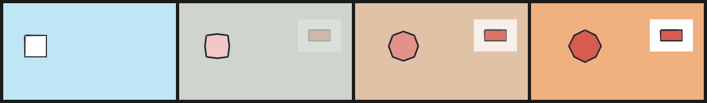

# 16. Colour expressions, morph, frame ranges and opacity

Published tools 0.5.0 implements spec [0.4.0-draft](../spec/SPEC-0.4.0-draft.md).
These constructs also work in source/unreleased tools 0.6.0 / spec 0.5. These four
constructs let one film hold each drawing once and describe the frames between
drawings as expressions, instead of a separate scene per frame.

**They need the Python reference renderer.** The native runtime 0.4.0
implements spec 0.3. A document that uses any of them, or declares
`northcel "0.4.0-draft"`, is rendered by the labelled Python reference
(`"renderer": "python-reference"`), on Linux too. A 0.3 document is unaffected.

## `mix`: a colour that changes

```text
color: mix($white, $red, smoothstep(10, 20, f))
paper { color: mix(#203040, #F0A060, t) }
outline: (mix($ink, #806040, t), 3px)
```

`mix(a, b, u)` takes two colours (hex, `rgb()`, `$name` or another `mix`) and a
number. `u` is evaluated per frame, may use `def` parameters, and is clamped to
0..1. Each channel is `floor(a + (b - a) * u + 0.5)` on the 0..255 values, with
no gamma conversion. It is accepted for every primitive colour, outline colour
and the paper. A palette entry cannot be a `mix`: keep both colours in the
palette and mix where you use them.

## `morph`: one shape becoming another

```text
morph arm(color: $ink, u: smoothstep(11, 18, f), samples: 64) {
  "<rings of drawing A>" => "<rings of drawing B>"
}
```

Ring *i* on the left pairs with ring *i* on the right; the ring counts must be
equal, the vertex counts need not be. At `u ≤ 0` the morph paints A's rings
exactly and at `u ≥ 1` B's. In between, each pair is put in the same winding,
resampled to `samples` points by arclength (default:
`min(1024, max(8, nA, nB))`), the start of B is rotated to the cyclic shift closest to A, and the
points are interpolated. `outline` and `opacity` work as on a `cel`. A morph
is a named entry like a layer: `drop`, `transform` and in-place replacement
apply to it.

Morph does not decide which shape corresponds to which; you (or
`tween --match`) do. A legal morph between unrelated shapes folds or swaps
through the middle. Look at the in-betweens.

## `frame A..B`: one block for a run of frames

`frame 12..18 { ... }` applies to frames 12 through 18. Exactly one block applies
to a frame: an exact `frame N` wins; otherwise the **last** range in the file that
contains the frame; otherwise none. Blocks are not combined, and `check` warns
about overlapping ranges. Inside a range, `f` and `t` are the actual frame's
values, so a transition over the range is `smoothstep(11, 19, f)`.

## `opacity`: translucent marks and dissolves

`opacity: 0.4` (any expression, clamped to 0..1) on a layer, cel, swarm, stroke,
ribbon or morph blends each covered subpixel towards the colour. On a `use` it is
**group opacity**: the whole definition is painted, then blended with what was
underneath, so overlapping parts inside it do not darken each other. A dissolve
between two drawings is `use A` then `use B(opacity: u)`, where `B` starts with a
full-canvas layer in its paper colour.

<!-- render: assets/guide/16-mix-morph-opacity.png frames=0,2,4,6 -->
```ncel
northcel "0.4.0-draft"
film Beat(width: 320, height: 180, fps: 12, frames: 7, precision: 0.25px) {
  palette { sky: #BFE6F4, dusk: #F0B080, ink: #202830, white: #FEFEFE, red: #D65C52 }
  paper { color: mix($sky, $dusk, t), antialias_grid: 4 }
  def Card {
    layer card_paper(color: $white) { "880,120 320,0 0,240 -320,0" }
    cel card(color: $red, outline: ($ink, 3px)) { "960,200 160,0 0,80 -160,0" }
  }
  morph shape(color: mix($white, $red, t), u: smoothstep(0, 6, f), samples: 48, outline: ($ink, 3px)) { "160,240 160,0 0,160 -160,0" => "400,200 80,40 40,80 -40,80 -80,40 -80,-40 -40,-80 40,-80" }
  frame 2..4 {
    use Card(opacity: (f - 1) / 4)
  }
  frame 5..6 {
    use Card
  }
}
```



Frames 0, 2, 4 and 6: the square morphs into an octagon with a different vertex
count and changes colour; the paper mixes from sky to dusk over the film; the card
fades in over frames 2–4 as a group (its white card paper and the red cel blend
together, not one through the other) and holds from frame 5.

## What goes wrong

<!-- expect-error: 3:3: error: Morph 'm' pairs ring i with ring i, but its sides have 2 and 1 rings -->
```text
northcel "0.4.0-draft"
scene Pair(width: 320, height: 180) {
  morph m(tone: 0, u: 0.5) { "0,0 40,0 0,40|80,80 40,0 0,40" => "0,0 80,0 0,80" }
}
```

Make one morph per ring pair, or give both sides the same number of rings.
Other located mistakes: a reversed range (`frame 5..2`), `mix` inside a palette,
a morph without `u`, and a spec 0.4 construct in a document whose header says
0.3 (the message names the header to use). `opacity` in a 0.3 document is
ignored with a warning, as it always was. See [common errors](../errors.md).

Next: [pattern 12, polishing AI frames](../patterns/12-polishing-ai-frames.md).
