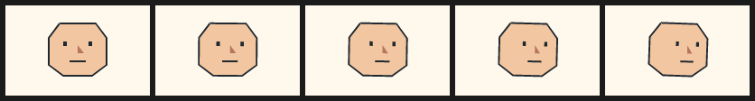
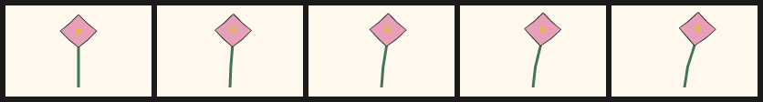
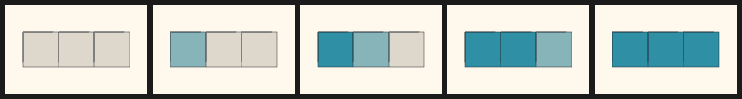
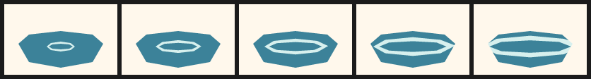

# 17. Editable drawings: observe, decide, edit, verify

**Tools 0.7.2, spec 0.6.0-draft.** These examples run with the published
`pip install "northcel[fit]"` (or `pipx install "northcel[fit]"`). Newer-spec
rendering uses the labelled Python reference, not the native runtime.

The method is **observe → decompose → decide → edit the delta → verify →
iterate**. The AI decides for each video what constitutes a part, what stays
copied, what moves, and what needs drawing again. NorthCel supplies general
building blocks and measurements, not subject recipes, a character rig library
or a head-turn preset. `tween --match` remains an optional experiment, not the
default way to author in-betweens.

## 1. Observe both keys before choosing a mechanism

Render the starting drawing and inspect it alongside the destination key at the
same dimensions. Note the intended timing, silhouette, occlusion order, landmarks,
colours and stationary regions. Ask what actually changes, not what a subject
usually does. Keep both original keys; a plausible midpoint can still fail to
connect to one of them.

For an existing image, `northcel fit key-a.png --stacked -o key-a.ncel --receipt
key-a.json` emits vector contours, not an embedded bitmap. Inspect the round
trip before editing. Optional [perception helpers](../perception.md) can suggest
masks or motion; they do not choose semantic parts or approve a result.
Interpolation guides are visual targets only, never output frames or quality
evidence. No perception backend is needed for the method.

## 2. Decompose into addressable regions

The stacked fit receipt has a `shape_manifest`: ids, colours, areas, bounding
boxes, centroids, neighbours and containment guesses. An id is `s` plus ten SHA-1
hex digits derived from colour and quantised geometry, with collision suffixes.
It is stable for that fitted geometry, **not** a semantic identity tracker across
independently fitted images. Preserve the emitted names while editing; refitting
a changed key can produce different ids.

Use queries to find candidate regions, then inspect them:

```sh
northcel shapes key-a.ncel --frame 0
northcel shapes key-a.ncel --color '#202830' --area-min 4 --area-max 500
northcel shapes key-a.ncel --bbox 40,10,120,90
northcel shapes key-a.ncel --centroid 80,50,30
northcel shapes key-a.ncel --mask selected-region.png
```

`--ids` accepts a comma-separated list of emitted ids; `--parent ID` queries
inferred containment. `--mask` selects by the shape centroid's mask pixel, not
exact overlap or clipping. Filters combine. These rows describe evaluated geometry:
areas sum absolute ring areas, centroids are area-weighted ring centroids,
containment uses bboxes and neighbours use centroid distance. They are not
visible clipped areas, occlusion reasoning or semantic parents. The query's
`parent` field is **not** the language's opt-in `parent:` attachment.

Wrap selected paints in a named `group`, preserving their names and source paint
order. Group fill and coupled outlines together; separate regions that need
different deltas. Do not group by colour alone when unrelated objects share it.

## 3. Decide: what is the smallest defensible change?

| Observation in these keys | Candidate edit | Reject it when… |
| --- | --- | --- |
| Same geometry, same placement | Copy with `def` / `use` | An inherited expression moves a supposedly stationary part |
| Same shape, new position/orientation/size | Group `transform` about an explicit pivot | Perspective or occlusion needs a new silhouette |
| Same visible material bending | `warp` with a few observed handles | The deformation folds contours or invents anatomy |
| One contour corner needs correcting | `nudge` on a named ring/vertex | Many unrelated vertices need moving; redraw that region instead |
| Same region, changing pigment/light | `mix` on its colour and, if needed, outline | The boundary itself moves; colour mixing alone is not a moving front |
| Existing marks slide behind a boundary | Group `clip` | Newly exposed content does not exist in the drawing |
| New angle, new pose, unseen prop or genuinely new topology | Draw a new key or just the missing region | A small code edit already expresses the observed change faithfully |

A low correspondence score or a failed automatic tween is **not** proof that a
redraw is needed. Conversely, translating eyes across a face cannot reveal an
unseen ear or construct a profile. Draw what is missing, retain what remains
valid, then bridge the smaller changes in code. A new key may be hand-authored
vector geometry; an image model is not required.

### General editing rules

- `group name(pivot: (x, y))` gives rotation/scale a centre in canvas pixels;
  the default is `(0, 0)`. `transform name(anchor: ...)` overrides the pivot.
  Translate, rotate and scale mutate already-painted geometry in source order.
- Groups nest. A sibling `group child(parent: other)` opts into the parent's
  transform/warp path without introducing a rig library. Paint the parent and
  child before transforming them. A parent is not an automatic joint solver.
- `clip: mask` uses the coverage of a named paint or group (the union of its
  paints). The mask itself still paints unless made invisible with `opacity: 0`.
  Clips are binary subpixel coverage, not feathered/image masks.
- `warp` blends handle displacement vectors inside `radius`. With only one
  contributing handle its normalised displacement is constant, not attenuated
  by distance; use fixed handles as well as moving handles to anchor a bend.
  Outside all handle radii, points stay unchanged. This is not ARAP or a physics
  simulation. See the [exact formula](../spec/SPEC-0.6.0-draft.md#warp).
- `nudge` uses zero-based integer `ring`/`vertex` indices after painting. Check
  the encoded ring order; it moves a vertex, not an inferred landmark.
- `mix(a, b, u)` clamps `u` and mixes 8-bit RGB channels without gamma
  conversion. There is no group-wide colour override: put `mix` on each
  selected paint/outline, sharing the same expression when appropriate.

## 4. Edit the delta, not a second copy of the drawing

Store the key once in a `def`. Each applicable frame block says `use Key`, then
only the changes. This saves source and review effort, not rasterisation work:
every requested frame is still evaluated and rendered. Changes never accumulate
from the preceding frame. Repeated uses do not rename their paints: same-named layers/cels, their coupled
outlines and morphs replace earlier entries, while strokes, ribbons and
ordinary swarms append. Use distinct paint names for independent instances,
and avoid expanding the same ink twice in one evaluated frame.

Keep width, height, fps, frame count and seed intact. `f` is the global frame
index; `t = f / max(1, frames - 1)`, not progress local to a range. Choose a
bounded expression over the actual transition. An exact `frame N` wins over a
range; otherwise the last containing range wins. Ranges do **not** combine.
Use disjoint blocks and preserve the key endpoints deliberately.

## Five worked illustrations — not templates

These five tiny films illustrate different decisions. They are **not subject
templates**, reusable rigs or predictions about another video's motion. Each is
a complete file to save and check; quoted rings use integer quarter-pixel deltas.
All five frames in each illustration are rendered below, left to right. Their
low sampling rate makes the edits legible; it is not a production cadence target.

### Illustration 1 — a modest head turn: copy and transform

**Observe/decompose:** the same face silhouette remains visible; only feature
spacing and a small overall tilt change. **Decide/edit:** reuse the drawing,
compress and slide the feature group, then rotate its parent about the neck-side
pivot. The sibling features opt into the head's transform path and clip to the
face. No new profile or hidden side is invented.

<!-- render: assets/guide/17-head-turn.png frames=0,1,2,3,4 cols=5 -->
```ncel
northcel "0.6.0-draft"
film TurnIllustration(width: 160, height: 100, fps: 5, frames: 5, seed: 17) {
  paper { color: #FFF8EC }
  def Key {
    group head(pivot: (80, 78)) {
      cel face_fill(color: #F2C6A0, outline: (#202830, 2px)) {
        "240,80 160,0 48,64 0,120 -64,48 -128,0 -64,-48 0,-120"
      }
    }
    group features(parent: head, pivot: (80, 46), clip: face_fill) {
      layer eyes(color: #202830) { "256,160 16,0 0,20 -16,0|368,160 16,0 0,20 -16,0" }
      layer nose(color: #B7765E) { "320,176 28,36 -28,0" }
      stroke mouth(color: #202830, width: 2px) { (71, 62), (89, 62) }
    }
  }
  frame 0 { use Key }
  frame 1..4 {
    use Key
    transform features(scale: (1 - 0.2 * t, 1), translate: (10 * t, 0))
    transform head(rotate: 2 * t)
  }
}
```



**Verify/iterate:** inspect feature attachment and the face boundary in onion
overlays; compare both real neighbours before accepting a turn. If the target
shows a new angle or an unseen ear, replace the necessary silhouette with a new
key. This illustration only suggests a small turn inside the existing view.

### Illustration 2 — a flower sway: anchored warp and pivot

**Observe/decompose:** the base stays planted while stem and bloom bend together.
**Decide/edit:** one fixed handle anchors the base; one moving handle displaces
the top, and a small rotation uses the base pivot. These handles and dimensions
belong to this drawing only.

<!-- render: assets/guide/17-flower-sway.png frames=0,1,2,3,4 cols=5 -->
```ncel
northcel "0.6.0-draft"
film SwayIllustration(width: 160, height: 100, fps: 5, frames: 5, seed: 17) {
  paper { color: #FFF8EC }
  def Key {
    group plant(pivot: (80, 90)) {
      stroke stem(color: #42765A, width: 3px) { (80, 90), (80, 68), (80, 46), (80, 28) }
      group bloom {
        cel petals(color: #E8A0B8, outline: (#202830, 1px)) {
          "320,40 40,40 40,32 -40,40 -40,32 -40,-32 -40,-40 40,-32"
        }
        layer centre(color: #E8B44E) { "308,100 24,0 0,24 -24,0" }
      }
    }
  }
  frame 0 { use Key }
  frame 1..4 {
    use Key
    warp plant(handles: ((80, 90, 0, 0), (80, 24, 12 * t, -3 * t)), radius: 60)
    transform plant(rotate: 2 * t)
  }
}
```



**Verify/iterate:** inspect the base, stem/bloom join and intermediate silhouette,
not just the endpoint displacement. A warp can keep its handles plausible while
folding an intervening contour. Add an observed constraint or redraw that contour
if it does; do not add a flower-specific helper.

### Illustration 3 — a colour flood: staggered `mix`, fixed geometry

**Observe/decompose:** pigment reaches three existing adjacent regions in order;
their boundaries stay fixed. **Decide/edit:** reuse the same geometry and change
only colour expressions with overlapping timing windows. This is a region-wise
colour flood, not a simulated liquid or a continuously travelling boundary.

<!-- render: assets/guide/17-colour-flood.png frames=0,1,2,3,4 cols=5 -->
```ncel
northcel "0.6.0-draft"
film FloodIllustration(width: 160, height: 100, fps: 5, frames: 5, seed: 17) {
  palette { dry: #DDD8CB, wet: #2E8FA5, ink: #202830 }
  paper { color: #FFF8EC }
  def Key {
    group field {
      cel left(color: mix($dry, $wet, smoothstep(0, 2, f)), outline: ($ink, 1px)) {
        "80,120 160,0 0,160 -160,0"
      }
      cel middle(color: mix($dry, $wet, smoothstep(1, 3, f)), outline: ($ink, 1px)) {
        "240,120 160,0 0,160 -160,0"
      }
      cel right(color: mix($dry, $wet, smoothstep(2, 4, f)), outline: ($ink, 1px)) {
        "400,120 160,0 0,160 -160,0"
      }
    }
  }
  frame 0..4 { use Key }
}
```



**Verify/iterate:** use RGB diff for colour, and query geometry to confirm that
boundaries have not moved. Onion uses luminance, so equal-luminance colour changes
can disappear from it. A moving pigment front would need separate geometry or a
changing clip rather than these three fixed cells.

### Illustration 4 — a cloud squash: nonuniform scale about its base

**Observe/decompose:** the outline compresses vertically and widens without
revealing new content. **Decide/edit:** scale the whole cel about a bottom-centre
pivot, keeping its coupled ink attached. A rigid matrix is sufficient here;
there is no need for handles or a cloud preset. Nonuniform scale is not rigid
motion, but it preserves this drawing's contour topology.

<!-- render: assets/guide/17-cloud-squash.png frames=0,1,2,3,4 cols=5 -->
```ncel
northcel "0.6.0-draft"
film SquashIllustration(width: 160, height: 100, fps: 5, frames: 5, seed: 17) {
  paper { color: #CDE3EA }
  def Key {
    group cloud(pivot: (80, 75)) {
      cel body(color: #FFFFFF, outline: (#526879, 2px)) {
        "140,248 0,-48 32,-32 40,0 20,-40 48,-16 48,16 24,32 44,-8 36,32 28,0 28,36 0,48 -48,32 -320,0"
      }
    }
  }
  frame 0 { use Key }
  frame 1..4 {
    use Key
    transform cloud(scale: (1 + 0.2 * t, 1 - 0.2 * t))
  }
}
```


**Verify/iterate:** continuity should show the intended gradual width/height
change and a stationary bottom edge; its bbox-centre can move even though the
pivot does not. The scale product is not constant, so this does **not** claim
area or volume conservation. If the reference rolls or folds, a single scale
will not reproduce it.

### Illustration 5 — a water ripple: clipped expansion and a local nudge

**Observe/decompose:** a highlight expands across a fixed water surface and
disappears at its boundary. **Decide/edit:** scale an even-odd ring, nudge one
outer-ring vertex for a small asymmetric crest, and clip the result to the
surface. The water boundary remains a copy. This is an authored mark, not a
water solver.

<!-- render: assets/guide/17-water-ripple.png frames=0,1,2,3,4 cols=5 -->
```ncel
northcel "0.6.0-draft"
film RippleIllustration(width: 160, height: 100, fps: 5, frames: 5, seed: 17) {
  paper { color: #FFF8EC }
  def Key {
    layer water_surface(color: #3C8299) {
      "80,224 60,-52 180,-20 180,20 60,52 -60,104 -180,32 -180,-32"
    }
    group ripple(pivot: (80, 60), clip: water_surface) {
      layer crest(color: #D7F0EE) {
        "400,240 -24,20 -56,8 -56,-8 -24,-20 24,-20 56,-8 56,8|388,240 -20,12 -48,4 -48,-4 -20,-12 20,-12 48,-4 48,4"
      }
    }
  }
  frame 0 { use Key }
  frame 1..4 {
    use Key
    nudge crest(vertex: 0, ring: 0, dx: 2 * t, dy: -1 * t)
    transform ripple(scale: (1 + 2.4 * t, 1 + 1.2 * t))
  }
}
```



**Verify/iterate:** inspect the hollow centre, crest continuity and the clipped
edges at full size. Continuity measures the ripple's **unclipped geometry**, not
its visible area; intentional expansion may trigger its height-jump flags. Do
not shrink a correct ripple merely to silence a heuristic.

## 5. Verify against both neighbours, then iterate

Save an illustration as `edit.ncel`. For a real transition, use its actual key
images and global frame index instead of the sample filenames/frame below.
References must have exactly the document's dimensions; no alignment or resizing
is implicit. Run from a writable scratch directory for generated evidence.

```sh
northcel check edit.ncel --json
northcel render edit.ncel --frame 2 -o candidate.png --json
northcel diff edit.ncel --frame 2 --against key-a.png -o diff-a.png --json
northcel diff edit.ncel --frame 2 --against key-b.png -o diff-b.png --json
northcel onion edit.ncel --frame 2 --against key-a.png -o onion-a.png --json
northcel onion edit.ncel --frame 2 --against key-b.png -o onion-b.png --json
northcel onion edit.ncel --frame 2 -o adjacent-onion.png --json
northcel contact edit.ncel -o contact.png --frames 0..4 --json
northcel contact edit.ncel -o transitions --transitions --json
northcel continuity edit.ncel --group head --json
northcel distinct edit.ncel --json
```

Use the group that actually exists (`head`, `plant`, `field`, `cloud` or `ripple`
here); `--shape ID` can narrow continuity inside that group. A static `check`
does not resolve every target or evaluate every expression. Render every authored
frame to catch missing clips, invalid vertex indices or frame-dependent errors.

| Evidence | What to look for | What it does **not** prove |
| --- | --- | --- |
| `diff`, both keys | RGB MAE/RMSE/PSNR, heatmaps and deliberate vs accidental differences; add `--region name:x0,y0,x1,y1` for a fixed region | A midpoint should not have zero error to both different keys; group errors use geometric bboxes, not isolated coverage masks |
| `onion`, neighbours | Detached ink, double edges, unwanted scale/position jumps | Luminance overlays can miss colour-only changes |
| `contact` | Read the complete transition in order, including key endpoints | `--transitions` follows declared frame blocks, not inferred scene cuts; it cannot combine with `--frames` |
| `continuity` | Bbox width/height, bbox-centre movement, disappearance and >8% adjacent height changes | It ignores clipping/opacity/occlusion; only height has that automatic threshold |
| `distinct` | Changed adjacent samples at 320×180; for final evidence use **all** frames | Not globally unique images or an artistic smoothness score; the first frame is excluded and sampling is exploratory |

All five measurement commands use the reference renderer. A successful command
means the measurement ran; a large diff or a continuity flag can still exit 0.
Keep the receipts, inspect the actual images at output size, and decide whether
each difference is intended. The distinct metric changes a pair above mean RGB
difference 0.2 in 8-bit units and divides the change count by sampled timeline
duration. Five changing frames at 5 fps can report at most 4 changes/s, not 5.

Render the same frame twice and compare decoded RGB for determinism. Change one
delta, render and compare again; if it still cannot connect the keys, reconsider
the decomposition or draw the missing region. Do not promote metric success,
perception hints or an interpolation guide into visual approval.

### Renderer boundary

The Vello prototype is an **experimental preview/fast-tier recommendation**, not
a shipped renderer switch or adopted conformance policy. It consumes evaluated
fixtures and has not established portable, byte-exact spec-0.5 rendering. Keep
the labelled reference for these checks and receipts; do not use Vello output
hashes as verification evidence. See the [prototype's limits](../../native/vello/README.md).

## 6. Keep authoring separate from optional assembly

This method works entirely with `northcel`; no other CLI is required. A separate
[optional local scaffold/assembly workflow](../workflows/authored-inbetweens.md)
describes a consumer CLI's own commands. Scaffolding is a starting copy, not
authored motion; assembly does not invent missing deltas. Review every transition
and preserve original keys before assembling a film.

See also: [agent guide](../agent-guide.md), [CLI reference](../reference.md),
[frame precedence](08-films-and-frame-overrides.md) and the
[spec 0.6 contract](../spec/SPEC-0.6.0-draft.md).
