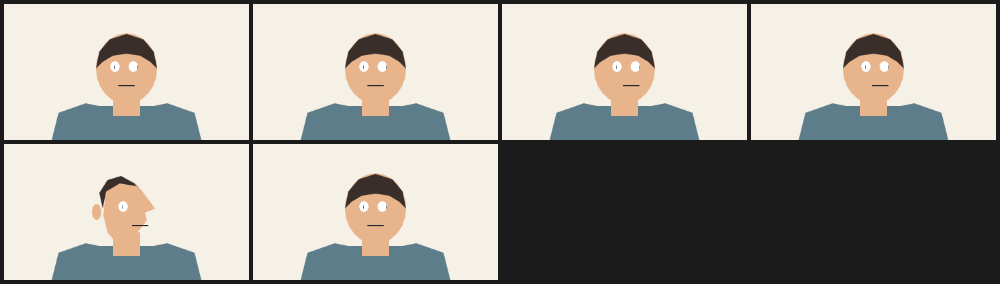

# 1. Head turn in 6 fps cels

A head turn is a silhouette change, not a slide. The base is a front view; `step(2, f)` and `step(4, f)` move the features in two quarter turns, and `- step(5, f)` brings them back, so the file describes a turn and a return without a single keyframe table.

The peak frame replaces the head and hair cels with a profile and drops the far eye. Because the override uses the same layer names, the new head lands in the original paint position instead of on top of the old one.

Six frames at 6 fps is one second: enough for a readable turn at the cadence of drawn animation on twos and threes.



| | |
| --- | --- |
| Source | [`examples/patterns/01-head-turn-6fps.ncel`](../../examples/patterns/01-head-turn-6fps.ncel) |
| Size | **2,339 bytes** · **1,107 cl100k tokens** |
| Timing | 6 frames at 6 fps (1.00 s) · 360×200 |
| Render | `northcel film examples/patterns/01-head-turn-6fps.ncel -o out/ --frames 0..5` |

## Why it works

The motion is two discrete steps, so it reads as cels rather than interpolation. The profile only exists for one frame, which is exactly how a short turn is posed in a hand-drawn sequence: anticipate with the features, hit the silhouette, come back.

## The file

<!-- source: examples/patterns/01-head-turn-6fps.ncel -->
```ncel
northcel "0.2.0-draft"

// A 6 fps head turn, drawn as cels: features slide in two quarter turns and the
// silhouette swaps to a profile for the peak frame, then returns. Everything is
// a pure function of t, f and the seed.

film HeadTurnSix(width: 360, height: 200, fps: 6, frames: 6, precision: 0.25px, seed: 108) {
  palette { ink: #22262E, skin: #E8B48C, hair: #3A2E2A, shirt: #5E7D8A }
  paper { color: #F6F1E7, antialias_grid: 4 }

  layer shoulders(color: $shirt, rings: 1) { "280,800 40,-160 160,-56 80,16 320,0 80,-16 160,56 40,160" }
  layer neck(color: $skin, rings: 1) { "640,520 160,0 0,140 -160,0" }
  layer head(color: $skin, rings: 1) { "900,380 -6,54 -18,50 -29,43 -37,33 -43,21 -47,7 -47,-7 -43,-21 -37,-33 -29,-43 -18,-50 -6,-54 6,-54 18,-50 29,-43 37,-33 43,-21 47,-7 47,7 43,21 37,33 29,43 18,50" }
  layer hair(color: $hair, rings: 1) { "540,380 20,-100 60,-72 100,-32 100,32 60,72 20,100 -40,-40 -60,-36 -80,-12 -80,12 -60,36" }

  layer eye_l(color: #FFFFFF, rings: 1, translate: (step(2, f) * 6 + step(4, f) * 6 - step(5, f) * 12, 0)) { "680,368 -4,16 -10,12 -14,4 -14,-4 -10,-12 -4,-16 4,-16 10,-12 14,-4 14,4 10,12" }
  layer eye_r(color: #FFFFFF, rings: 1, translate: (step(2, f) * 6 + step(4, f) * 6 - step(5, f) * 12, 0)) { "788,368 -4,16 -10,12 -14,4 -14,-4 -10,-12 -4,-16 4,-16 10,-12 14,-4 14,4 10,12" }
  layer pupil_l(color: $ink, rings: 1, translate: (step(2, f) * 6 + step(4, f) * 6 - step(5, f) * 12, 0)) { "652,372 0,16 -4,-16 4,-16" }
  layer pupil_r(color: $ink, rings: 1, translate: (step(2, f) * 6 + step(4, f) * 6 - step(5, f) * 12, 0)) { "788,372 0,16 -4,-16 4,-16" }
  layer nose(color: $skin, rings: 1, translate: (step(2, f) * 8 + step(4, f) * 8 - step(5, f) * 16, 0)) { "696,432 48,0 -24,32" }
  stroke mouth(color: $ink, taper: (2, 2)) { (168 + step(2, f) * 10 + step(4, f) * 10 - step(5, f) * 20, 120), (192 + step(2, f) * 10 + step(4, f) * 10 - step(5, f) * 20, 120) }

  frame 4 {
    layer hair(color: $hair, rings: 1) { "580,380 20,-100 80,-48 100,16 40,48 -52,-64 -80,-44 -80,24 -48,76" }
    layer head(color: $skin, rings: 1) { "600,240 100,-20 80,20 40,48 68,92 -60,24 12,44 -48,64 -72,48 -60,24 -52,-64 -24,-100" }
    layer ear(color: $skin, rings: 1) { "572,400 -4,24 -10,18 -14,6 -14,-6 -10,-18 -4,-24 4,-24 10,-18 14,-6 14,6 10,18" }
    drop eye_r
    drop pupil_r
  }
}
```

## Pitfalls

- A `frame 4` override replaces the whole named layer, including its `translate:`. If the replacement needs to be somewhere else, write the position into the override.
- If you move the eyes but not the pupils, the pupils stay behind. Every feature that belongs together needs the same expression.
- `step(edge, f)` is `1` for `f >= edge` and stays `1`; subtract a later step if you want the value to come back down.
- Dropping `eye_r` without dropping `pupil_r` leaves a floating pupil.

## Reproduce it

```console
$ northcel check examples/patterns/01-head-turn-6fps.ncel
$ northcel film examples/patterns/01-head-turn-6fps.ncel -o frames/ --frames 0..5
```

The contact sheet above is generated by `docs/scripts/build_docs_assets.py` from
those same frames. The docs check renders every pattern again and compares the
pixels, so the image and the file cannot drift apart.

Next: [patterns index](README.md) · [the guide](../guide/README.md) ·
[gallery](../gallery.md).
