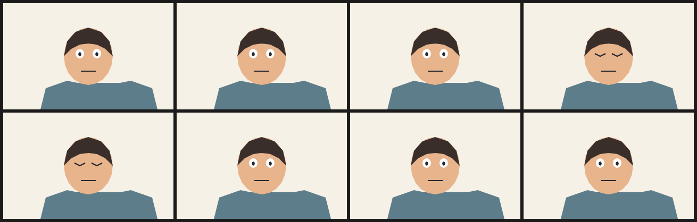

# 2. Blink

A blink is two frames of closed lids over a drawing that does not otherwise change. The open eyes are cels; the closed lids are strokes declared only inside `frame 3` and `frame 4`.

At 12 fps the blink lasts about 170 ms, which is the length a real blink reads as an event rather than a slow fade. Frames 0–2 and 5–7 are the base drawing untouched.



| | |
| --- | --- |
| Source | [`examples/patterns/02-blink.ncel`](../../examples/patterns/02-blink.ncel) |
| Size | **1,818 bytes** · **833 cl100k tokens** |
| Timing | 8 frames at 12 fps (0.67 s) · 320×200 |
| Render | `northcel film examples/patterns/02-blink.ncel -o out/ --frames 0..7` |

## Why it works

Dropping the eyeball cels and appending lid strokes is a smaller change than drawing a second face. It is also exactly the delta a creator would describe: close the eyes for two frames.

## The file

<!-- source: examples/patterns/02-blink.ncel -->
```ncel
northcel "0.2.0-draft"

// A two-frame blink at 12 fps. The open eyes are cels; the closed lids are
// strokes declared only in the two blink frames. Nothing else changes.

film BlinkTwelve(width: 320, height: 200, fps: 12, frames: 8, precision: 0.25px, seed: 208) {
  palette { ink: #22262E, skin: #E8B48C, hair: #3A2E2A, shirt: #5E7D8A }
  paper { color: #F6F1E7, antialias_grid: 4 }

  layer shoulders(color: $shirt, rings: 1) { "280,800 40,-160 160,-56 80,16 320,0 80,-16 160,56 40,160" }
  layer face(color: $skin, rings: 1) { "824,400 -9,67 -26,60 -41,48 -51,30 -57,11 -57,-11 -51,-30 -41,-48 -26,-60 -9,-67 9,-67 26,-60 41,-48 51,-30 57,-11 57,11 51,30 41,48 26,60" }
  layer hair(color: $hair, rings: 1) { "456,400 24,-112 64,-72 96,-32 96,32 64,72 24,112 -56,-56 -64,-32 -64,-8 -64,8 -64,32" }
  layer eye_l(color: #FFFFFF, rings: 1) { "608,380 -4,18 -12,13 -16,5 -16,-5 -12,-13 -4,-18 4,-18 12,-13 16,-5 16,5 12,13" }
  layer eye_r(color: #FFFFFF, rings: 1) { "736,380 -4,18 -12,13 -16,5 -16,-5 -12,-13 -4,-18 4,-18 12,-13 16,-5 16,5 12,13" }
  layer pupil_l(color: $ink, rings: 1) { "588,384 -4,11 -8,5 -8,-5 -4,-11 4,-11 8,-5 8,5" }
  layer pupil_r(color: $ink, rings: 1) { "716,384 -4,11 -8,5 -8,-5 -4,-11 4,-11 8,-5 8,5" }
  stroke mouth(color: $ink, taper: (2.2, 2.2)) { (146, 128), (174, 128) }

  frame 3 {
    drop eye_l
    drop eye_r
    drop pupil_l
    drop pupil_r
    stroke lid_l(color: $ink, taper: (2.4, 2.4)) { (134, 95), (144, 100), (154, 95) }
    stroke lid_r(color: $ink, taper: (2.4, 2.4)) { (166, 95), (176, 100), (186, 95) }
  }
  frame 4 {
    drop eye_l
    drop eye_r
    drop pupil_l
    drop pupil_r
    stroke lid_l(color: $ink, taper: (2.4, 2.4)) { (134, 95), (144, 100), (154, 95) }
    stroke lid_r(color: $ink, taper: (2.4, 2.4)) { (166, 95), (176, 100), (186, 95) }
  }
}
```

## Pitfalls

- `drop` removes a layer for one frame only. If the blink should last two frames, declare the override in both frames, as this file does.
- A closed lid is a curve, not a filled shape. Using a three-point `stroke` keeps it thin; a `layer` triangle reads as a dark wedge.
- Do not animate the lid with a `translate:` on the open eye: the eyeball would slide instead of closing.

## Reproduce it

```console
$ northcel check examples/patterns/02-blink.ncel
$ northcel film examples/patterns/02-blink.ncel -o frames/ --frames 0..7
```

The contact sheet above is generated by `docs/scripts/build_docs_assets.py` from
those same frames. The docs check renders every pattern again and compares the
pixels, so the image and the file cannot drift apart.

Next: [patterns index](README.md) · [the guide](../guide/README.md) ·
[gallery](../gallery.md).
