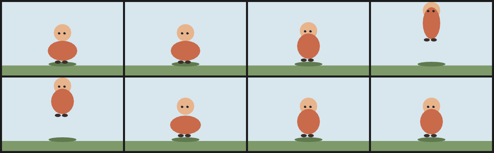

# 3. Jump with anticipation and squash

The jump is one pure expression: the body travels up on `sin(pi * (f - 2) / 3)` between frames 2 and 5, and a small positive offset crouches it on frames 0–1. The four key poses change only the body's shape — crouch, stretch, land — while the head, feet and eyes follow the same travel expression.

Anticipation and squash are what make a jump read as weight: the character compresses before it leaves and again when it lands. The stretch at the apex is the opposite pose, not a scale factor.



| | |
| --- | --- |
| Source | [`examples/patterns/03-jump-anticipation-squash.ncel`](../../examples/patterns/03-jump-anticipation-squash.ncel) |
| Size | **3,301 bytes** · **1,690 cl100k tokens** |
| Timing | 8 frames at 8 fps (1.00 s) · 360×220 |
| Render | `northcel film examples/patterns/03-jump-anticipation-squash.ncel -o out/ --frames 0..7` |

## Why it works

All the parts share one travel expression and the overrides redeclare it, so the body never detaches from the head. The body shapes are hand-authored rings, so the squash is a drawing decision instead of a transform of the standing pose.

## The file

<!-- source: examples/patterns/03-jump-anticipation-squash.ncel -->
```ncel
northcel "0.2.0-draft"

// A jump with anticipation and squash at 8 fps. The body shape changes only on
// the four key poses; the airborne travel is one pure expression of f.

film JumpEight(width: 360, height: 220, fps: 8, frames: 8, precision: 0.25px, seed: 308) {
  palette { ink: #22262E, coat: #C96A4A, boot: #3A2E2A, night: #6C7FA0 }
  paper { color: #F6F1E7, antialias_grid: 4 }

  layer sky(color: #D8E6EE, rings: 1) { "0,0 1440,0 0,880 -1440,0" }
  layer ground(color: #7E9A6A, rings: 1) { "0,760 1440,0 0,160 -1440,0" }
  layer shadow(color: #5E7A4E, rings: 1) { "888,744 -13,11 -36,9 -55,6 -64,2 -64,-2 -55,-6 -36,-9 -13,-11 13,-11 36,-9 55,-6 64,-2 64,2 55,6 36,9" }

  layer head(color: #E8B48C, rings: 1, translate: (0, -70 * sin(3.14159 * (f - 2) / 3) * (step(2, f) - step(5, f)) + 6 * (1 - step(2, f)))) {
    "824,344 -6,36 -18,31 -28,23 -34,12 -36,0 -34,-12 -28,-23 -18,-31 -6,-36 6,-36 18,-31 28,-23 34,-12 36,0 34,12 28,23 18,31"
  }
  layer body(color: $coat, rings: 1, translate: (0, -70 * sin(3.14159 * (f - 2) / 3) * (step(2, f) - step(5, f)) + 6 * (1 - step(2, f)))) {
    "856,528 -7,47 -19,42 -30,34 -38,22 -42,7 -42,-7 -38,-22 -30,-34 -19,-42 -7,-47 7,-47 19,-42 30,-34 38,-22 42,-7 42,7 38,22 30,34 19,42"
  }
  layer foot_l(color: $boot, rings: 1, translate: (0, -70 * sin(3.14159 * (f - 2) / 3) * (step(2, f) - step(5, f)) + 6 * (1 - step(2, f)))) {
    "700,696 -5,10 -13,7 -18,3 -18,-3 -13,-7 -5,-10 5,-10 13,-7 18,-3 18,3 13,7"
  }
  layer foot_r(color: $boot, rings: 1, translate: (0, -70 * sin(3.14159 * (f - 2) / 3) * (step(2, f) - step(5, f)) + 6 * (1 - step(2, f)))) {
    "784,696 -5,10 -13,7 -18,3 -18,-3 -13,-7 -5,-10 5,-10 13,-7 18,-3 18,3 13,7"
  }
  layer eye_l(color: $ink, rings: 1, translate: (0, -70 * sin(3.14159 * (f - 2) / 3) * (step(2, f) - step(5, f)) + 6 * (1 - step(2, f)))) {
    "700,344 -4,12 -10,8 -12,0 -8,-8 -0,-10 8,-8 10,0 8,8 4,10"
  }
  layer eye_r(color: $ink, rings: 1, translate: (0, -70 * sin(3.14159 * (f - 2) / 3) * (step(2, f) - step(5, f)) + 6 * (1 - step(2, f)))) {
    "764,344 -4,12 -10,8 -12,0 -8,-8 -0,-10 8,-8 10,0 8,8 4,10"
  }

  frame 0 {
    layer body(color: $coat, rings: 1, translate: (0, -70 * sin(3.14159 * (f - 2) / 3) * (step(2, f) - step(5, f)) + 6 * (1 - step(2, f)))) { "896,560 -9,37 -25,34 -39,26 -49,17 -54,6 -54,-6 -49,-17 -39,-26 -25,-34 -9,-37 9,-37 25,-34 39,-26 49,-17 54,-6 54,6 49,17 39,26 25,34" }
  }
  frame 1 {
    layer body(color: $coat, rings: 1, translate: (0, -70 * sin(3.14159 * (f - 2) / 3) * (step(2, f) - step(5, f)) + 6 * (1 - step(2, f)))) { "896,560 -9,37 -25,34 -39,26 -49,17 -54,6 -54,-6 -49,-17 -39,-26 -25,-34 -9,-37 9,-37 25,-34 39,-26 49,-17 54,-6 54,6 49,17 39,26 25,34" }
  }
  frame 3 {
    layer body(color: $coat, rings: 1, translate: (0, -70 * sin(3.14159 * (f - 2) / 3) * (step(2, f) - step(5, f)) + 6 * (1 - step(2, f)))) { "824,496 -5,59 -15,54 -23,42 -29,28 -32,9 -32,-9 -29,-28 -23,-42 -15,-54 -5,-59 5,-59 15,-54 23,-42 29,-28 32,-9 32,9 29,28 23,42 15,54" }
  }
  frame 5 {
    layer body(color: $coat, rings: 1, translate: (0, -70 * sin(3.14159 * (f - 2) / 3) * (step(2, f) - step(5, f)) + 6 * (1 - step(2, f)))) { "904,568 -9,35 -26,31 -41,25 -51,16 -57,5 -57,-5 -51,-16 -41,-25 -26,-31 -9,-35 9,-35 26,-31 41,-25 51,-16 57,-5 57,5 51,16 41,25 26,31" }
  }
}
```

## Pitfalls

- A replacement layer does not inherit `translate:`. Every override body repeats the travel expression; without it the body stays on the ground while the head flies.
- The feet are separate cels, so they follow the travel too. If a jump should tuck the legs, animate the feet separately rather than moving the whole body.
- `sin(pi * (f - 2) / 3)` is only the airborne arc while the `step(2, f) - step(5, f)` gate is 1; outside that window the sine would go negative.

## Reproduce it

```console
$ northcel check examples/patterns/03-jump-anticipation-squash.ncel
$ northcel film examples/patterns/03-jump-anticipation-squash.ncel -o frames/ --frames 0..7
```

The contact sheet above is generated by `docs/scripts/build_docs_assets.py` from
those same frames. The docs check renders every pattern again and compares the
pixels, so the image and the file cannot drift apart.

Next: [patterns index](README.md) · [the guide](../guide/README.md) ·
[gallery](../gallery.md).
