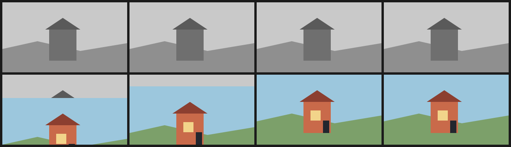

# 4. Colour filling at a specific beat

The grey scene is the base. A second set of layers, in colour, waits below the canvas and rises in three discrete steps at frames 4, 5 and 6, covering the grey exactly when the beat lands.

Nothing changes colour in place: the colour plate is a complete second drawing, translated as a group. That is the cheapest way to make colour arrive on a cue without 8 separate recolours.



| | |
| --- | --- |
| Source | [`examples/patterns/04-colour-beat.ncel`](../../examples/patterns/04-colour-beat.ncel) |
| Size | **1,909 bytes** · **867 cl100k tokens** |
| Timing | 8 frames at 8 fps (1.00 s) · 320×180 |
| Render | `northcel film examples/patterns/04-colour-beat.ncel -o out/ --frames 0..7` |

## Why it works

The beat is a `step(4, f)` gate rather than a fade, so the colour arrives on the frame you asked for. The three rising positions are three `step` terms, which makes the in-between drawing explicit in the file.

## The file

<!-- source: examples/patterns/04-colour-beat.ncel -->
```ncel
northcel "0.2.0-draft"

// Colour arrives at a specific beat. The grey drawing is the base; the colour
// plate is drawn over it and rises in three steps until it covers the frame.

film ColourBeat(width: 320, height: 180, fps: 8, frames: 8, precision: 0.25px, seed: 404) {
  palette { ink: #22262E, grey_sky: #C9C9C9, grey_hill: #8F8F8F, grey_house: #6F6F6F, grey_roof: #5A5A5A, sky: #9CC7DD, hill: #7CA06A, house: #C96A4A, roof: #8C3F30, glass: #F2D48A }
  paper { color: #F6F1E7, antialias_grid: 4 }

  layer sky(color: $grey_sky, rings: 1) { "0,0 1280,0 0,720 -1280,0" }
  layer hill(color: $grey_hill, rings: 1) { "0,480 360,-80 440,100 480,-80 0,300 -1280,0" }
  layer house(color: $grey_house, rings: 1) { "480,280 280,0 0,320 -280,0" }
  layer roof(color: $grey_roof, rings: 1) { "440,280 180,-120 180,120" }

  layer sky_fill(color: $sky, rings: 1, translate: (0, 180 * (1 - step(4, f)) + 60 * (step(4, f) - step(5, f)) + 30 * (step(5, f) - step(6, f)))) { "0,0 1280,0 0,720 -1280,0" }
  layer hill_fill(color: $hill, rings: 1, translate: (0, 180 * (1 - step(4, f)) + 60 * (step(4, f) - step(5, f)) + 30 * (step(5, f) - step(6, f)))) { "0,480 360,-80 440,100 480,-80 0,300 -1280,0" }
  layer house_fill(color: $house, rings: 1, translate: (0, 180 * (1 - step(4, f)) + 60 * (step(4, f) - step(5, f)) + 30 * (step(5, f) - step(6, f)))) { "480,280 280,0 0,320 -280,0" }
  layer roof_fill(color: $roof, rings: 1, translate: (0, 180 * (1 - step(4, f)) + 60 * (step(4, f) - step(5, f)) + 30 * (step(5, f) - step(6, f)))) { "440,280 180,-120 180,120" }
  layer window(color: $glass, rings: 1, translate: (0, 180 * (1 - step(4, f)) + 60 * (step(4, f) - step(5, f)) + 30 * (step(5, f) - step(6, f)))) { "552,368 104,0 0,104 -104,0" }
  layer door(color: $ink, rings: 1, translate: (0, 180 * (1 - step(4, f)) + 60 * (step(4, f) - step(5, f)) + 30 * (step(5, f) - step(6, f)))) { "680,472 64,0 0,128 -64,0" }
}
```

## Pitfalls

- The colour layers must be painted after the grey scene, or the grey covers them.
- Each coloured part needs the same translate expression; one forgotten layer leaves a grey hole.
- At the in-between frames the two drawings coexist. That is deliberate here; if it is not, snap in one step instead of three.

## Reproduce it

```console
$ northcel check examples/patterns/04-colour-beat.ncel
$ northcel film examples/patterns/04-colour-beat.ncel -o frames/ --frames 0..7
```

The contact sheet above is generated by `docs/scripts/build_docs_assets.py` from
those same frames. The docs check renders every pattern again and compares the
pixels, so the image and the file cannot drift apart.

Next: [patterns index](README.md) · [the guide](../guide/README.md) ·
[gallery](../gallery.md).
