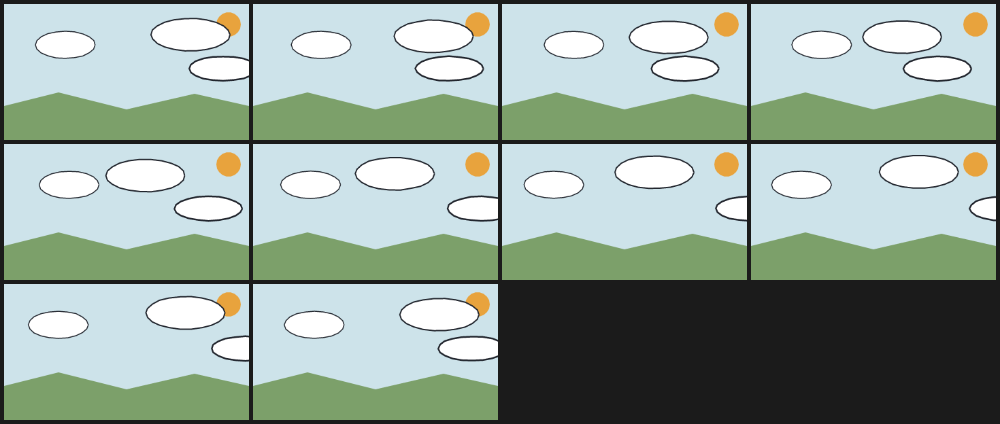

# 5. Cloud drift

Three clouds at three depths drift on three sine waves with different amplitudes and phases. The far cloud moves 16 px, the mid cloud 34 px, the near cloud 52 px, so the layers separate without any of them leaving the frame.

Each cloud is a `cel` with a coupled outline and a small `boil`; the outline and the fill wobble together because they are one drawing decision.



| | |
| --- | --- |
| Source | [`examples/patterns/05-cloud-drift.ncel`](../../examples/patterns/05-cloud-drift.ncel) |
| Size | **1,540 bytes** · **736 cl100k tokens** |
| Timing | 10 frames at 10 fps (1.00 s) · 360×200 |
| Render | `northcel film examples/patterns/05-cloud-drift.ncel -o out/ --frames 0..9` |

## Why it works

Parallax is amplitude, not perspective. A larger sine on the near layer is enough to read as depth, and because it is a sine the clouds come back instead of wrapping.

## The file

<!-- source: examples/patterns/05-cloud-drift.ncel -->
```ncel
northcel "0.2.0-draft"

// One sky, three clouds at three depths. Each cloud drifts on its own sine at a
// different amplitude, so the layers separate without leaving the frame.

film CloudDrift(width: 360, height: 200, fps: 10, frames: 10, precision: 0.25px, seed: 505) {
  palette { ink: #22262E, sky: #CDE3EA, sun: #E8A33D, cloud: #FFFFFF, hill: #7CA06A }
  paper { color: #F6F1E7, antialias_grid: 4 }

  layer sky(color: $sky, rings: 1) { "0,0 1440,0 0,800 -1440,0" }
  layer sun(color: $sun, rings: 1) { "1392,120 -4,25 -13,21 -19,16 -23,9 -26,0 -23,-9 -19,-16 -13,-21 -4,-25 4,-25 13,-21 19,-16 23,-9 26,0 23,9 19,16 13,21" }
  cel cloud_far(color: $cloud, outline: ($ink, 1.5px), boil: 0.25px, translate: (sin(t * 6.28318) * 16, 0)) {
    "536,240 -9,25 -25,22 -39,18 -49,11 -54,4 -54,-4 -49,-11 -39,-18 -25,-22 -9,-25 9,-25 25,-22 39,-18 49,-11 54,-4 54,4 49,11 39,18 25,22"
  }
  cel cloud_mid(color: $cloud, outline: ($ink, 2px), boil: 0.35px, translate: (sin(t * 6.28318 + 1.6) * 34, sin(t * 6.28318) * 4)) {
    "1192,180 -9,27 -28,25 -43,21 -56,14 -63,8 -66,0 -63,-8 -56,-14 -43,-21 -28,-25 -9,-27 9,-27 28,-25 43,-21 56,-14 63,-8 66,0 63,8 56,14 43,21 28,25"
  }
  cel cloud_near(color: $cloud, outline: ($ink, 2.5px), boil: 0.45px, translate: (sin(t * 6.28318 + 3.1) * 52, 0)) {
    "1480,380 -10,22 -28,20 -44,16 -56,10 -62,4 -62,-4 -56,-10 -44,-16 -28,-20 -10,-22 10,-22 28,-20 44,-16 56,-10 62,-4 62,4 56,10 44,16 28,20"
  }
  layer hill(color: $hill, rings: 1) { "0,600 320,-80 400,100 400,-92 320,72 0,200 -1440,0" }
}
```

## Pitfalls

- `sin(t * 6.28318)` completes one cycle over the film; multiply `t` for more cycles or add a phase offset to desynchronise layers.
- Without a phase offset all clouds move together and the depth collapses.
- A cloud that leaves the canvas does not wrap. Use a bounded sine or two clouds with a gap.

## Reproduce it

```console
$ northcel check examples/patterns/05-cloud-drift.ncel
$ northcel film examples/patterns/05-cloud-drift.ncel -o frames/ --frames 0..9
```

The contact sheet above is generated by `docs/scripts/build_docs_assets.py` from
those same frames. The docs check renders every pattern again and compares the
pixels, so the image and the file cannot drift apart.

Next: [patterns index](README.md) · [the guide](../guide/README.md) ·
[gallery](../gallery.md).
