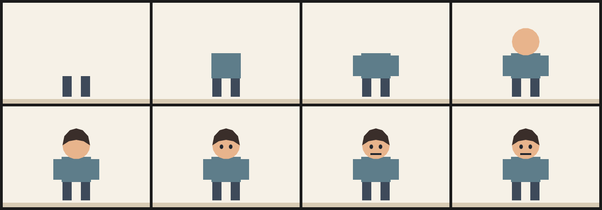

# 6. Character assembled progressively

Each part waits below the canvas and enters on its own `step(k, f)`, so the build order is legible in the file: legs, torso, arms, head, hair, eyes, mouth. Frame 7 is the finished character.

This is the constructive version of a reveal. Nothing is hidden or faded; the parts simply are not in the frame yet.



| | |
| --- | --- |
| Source | [`examples/patterns/06-progressive-assembly.ncel`](../../examples/patterns/06-progressive-assembly.ncel) |
| Size | **1,714 bytes** · **784 cl100k tokens** |
| Timing | 8 frames at 6 fps (1.33 s) · 320×220 |
| Render | `northcel film examples/patterns/06-progressive-assembly.ncel -o out/ --frames 0..7` |

## Why it works

One part per beat makes the assembly readable and keeps every part independently editable. The staging is one expression per part, so changing the order is changing one number.

## The file

<!-- source: examples/patterns/06-progressive-assembly.ncel -->
```ncel
northcel "0.2.0-draft"

// A character assembled one part per frame. Each part waits below the canvas and
// enters on its own step(k, f), so the build order is readable in the file.

film ProgressiveAssembly(width: 320, height: 220, fps: 6, frames: 8, precision: 0.25px, seed: 606) {
  palette { ink: #22262E, skin: #E8B48C, hair: #3A2E2A, shirt: #5E7D8A, trouser: #3E4A5A }
  paper { color: #F6F1E7, antialias_grid: 4 }
  layer ground(color: #D8CBB4, rings: 1) { "0,840 1280,0 0,80 -1280,0" }

  layer legs(color: $trouser, rings: 1, translate: (0, 240 * (1 - step(0, f)))) { "520,820 0,-180 80,0 0,180 80,0 0,-180 80,0 0,180" }
  layer torso(color: $shirt, rings: 1, translate: (0, 240 * (1 - step(1, f)))) { "512,660 0,-220 256,0 0,220" }
  layer arm_l(color: $shirt, rings: 1, translate: (0, 240 * (1 - step(2, f)))) { "440,640 0,-180 72,0 0,180" }
  layer arm_r(color: $shirt, rings: 1, translate: (0, 240 * (1 - step(2, f)))) { "768,640 0,-180 72,0 0,180" }
  layer head(color: $skin, rings: 1, translate: (0, 240 * (1 - step(3, f)))) { "760,340 -7,41 -21,36 -32,27 -39,14 -42,0 -39,-14 -32,-27 -21,-36 -7,-41 7,-41 21,-36 32,-27 39,-14 42,0 39,14 32,27 21,36" }
  layer hair(color: $hair, rings: 1, translate: (0, 240 * (1 - step(4, f)))) { "520,340 16,-80 48,-52 56,-16 56,16 48,52 16,80 -56,-36 -64,-12 -64,12" }
  layer eye_l(color: $ink, rings: 1, translate: (0, 240 * (1 - step(5, f)))) { "616,352 -3,12 -8,7 -10,0 -8,-7 -3,-12 3,-12 8,-7 10,0 8,7" }
  layer eye_r(color: $ink, rings: 1, translate: (0, 240 * (1 - step(5, f)))) { "696,352 -3,12 -8,7 -10,0 -8,-7 -3,-12 3,-12 8,-7 10,0 8,7" }
  layer mouth(color: $ink, rings: 1, translate: (0, 240 * (1 - step(6, f)))) { "592,408 96,0 0,16 -96,0" }
}
```

## Pitfalls

- `step(0, f)` is 1 on every frame, so a part with `k = 0` is present from the start.
- The off-canvas staging distance must exceed the canvas height, or a waiting part peeks in at the bottom.
- Parts drawn earlier are covered by later parts. Assemble in paint order, or the head can end up behind the torso.

## Reproduce it

```console
$ northcel check examples/patterns/06-progressive-assembly.ncel
$ northcel film examples/patterns/06-progressive-assembly.ncel -o frames/ --frames 0..7
```

The contact sheet above is generated by `docs/scripts/build_docs_assets.py` from
those same frames. The docs check renders every pattern again and compares the
pixels, so the image and the file cannot drift apart.

Next: [patterns index](README.md) · [the guide](../guide/README.md) ·
[gallery](../gallery.md).
