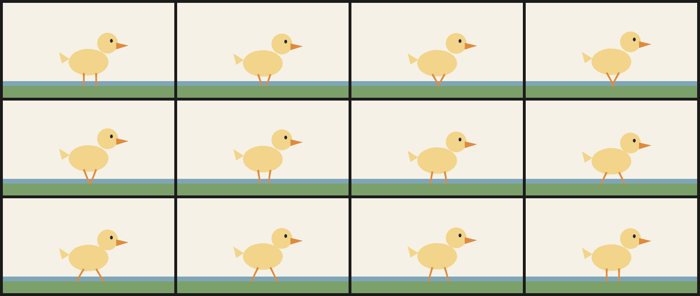

# 7. Duck walk

The duck's body bobs on `sin(t * 12.56636)` (two cycles over the film) while the two legs swing in opposite phase on `sin(t * 6.28318)`. The head and beak add a second, slower bob so the neck does not look rigid.

Legs are strokes, so the swing is written directly into their endpoint coordinates. Twelve frames at 12 fps is one second, a complete left-right-left cycle.



| | |
| --- | --- |
| Source | [`examples/patterns/07-duck-walk.ncel`](../../examples/patterns/07-duck-walk.ncel) |
| Size | **1,683 bytes** · **787 cl100k tokens** |
| Timing | 12 frames at 12 fps (1.00 s) · 360×200 |
| Render | `northcel film examples/patterns/07-duck-walk.ncel -o out/ --frames 0..11` |

## Why it works

A walk cycle is phase, not extra drawings: two legs on opposite sines and a body bob give the waddle. The beak and eye follow the head because they share its expression.

## The file

<!-- source: examples/patterns/07-duck-walk.ncel -->
```ncel
northcel "0.2.0-draft"

// A duck walk at 12 fps. The body bobs, the two legs swing in opposite phase,
// and the head follows the body. The legs are strokes so the swing is written
// directly into their coordinates.

film DuckWalk(width: 360, height: 200, fps: 12, frames: 12, precision: 0.25px, seed: 707) {
  palette { ink: #22262E, duck: #F2D48A, beak: #E08A3C, pond: #7FA6B8 }
  paper { color: #F6F1E7, antialias_grid: 4 }

  layer pond(color: $pond, rings: 1) { "0,660 1440,0 0,220 -1440,0" }
  layer grass(color: #7CA06A, rings: 1) { "0,700 1440,0 0,100 -1440,0" }

  layer body(color: $duck, rings: 1, boil: 0.2px, translate: (0, sin(t * 12.56636) * 3)) { "888,500 -7,32 -20,29 -31,24 -40,17 -46,9 -48,0 -46,-9 -40,-17 -31,-24 -20,-29 -7,-32 7,-32 20,-29 31,-24 40,-17 46,-9 48,0 46,9 40,17 31,24 20,29" }
  layer tail(color: $duck, rings: 1, translate: (0, sin(t * 12.56636) * 3)) { "560,472 -88,-56 24,96" }
  layer head(color: $duck, rings: 1, translate: (0, sin(t * 12.56636) * 3 - sin(t * 6.28318) * 2)) { "968,340 -5,30 -16,27 -23,19 -29,11 -30,0 -29,-11 -23,-19 -16,-27 -5,-30 5,-30 16,-27 23,-19 29,-11 30,0 29,11 23,19 16,27" }
  layer beak(color: $beak, rings: 1, translate: (0, sin(t * 12.56636) * 3 - sin(t * 6.28318) * 2)) { "952,336 104,24 -104,32" }
  layer eye(color: $ink, rings: 1, translate: (0, sin(t * 12.56636) * 3 - sin(t * 6.28318) * 2)) { "924,320 -2,9 -6,6 -8,0 -6,-6 -2,-9 2,-9 6,-6 8,0 6,6" }

  stroke leg_l(color: $beak, taper: (4, 3)) {
    (170, 148 + sin(t * 12.56636) * 3), (170 + sin(t * 6.28318) * 16, 176)
  }
  stroke leg_r(color: $beak, taper: (4, 3)) {
    (196, 148 + sin(t * 12.56636) * 3), (196 - sin(t * 6.28318) * 16, 176)
  }
}
```

## Pitfalls

- If the legs use the same phase, the duck hops instead of walking.
- Strokes have no `translate:`. Put the bob into the point expressions or the legs detach from the body.
- Two cycles of body bob against one cycle of leg swing is deliberate; matching them makes the walk stiff.

## Reproduce it

```console
$ northcel check examples/patterns/07-duck-walk.ncel
$ northcel film examples/patterns/07-duck-walk.ncel -o frames/ --frames 0..11
```

The contact sheet above is generated by `docs/scripts/build_docs_assets.py` from
those same frames. The docs check renders every pattern again and compares the
pixels, so the image and the file cannot drift apart.

Next: [patterns index](README.md) · [the guide](../guide/README.md) ·
[gallery](../gallery.md).
