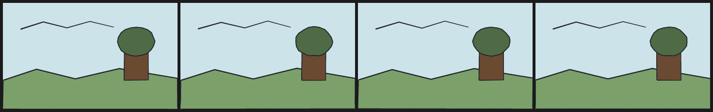

# 8. Line boil that reads as hand-drawn

Nothing in this drawing moves. The hill, tree, foliage and ridge line each carry a different `boil` amplitude (0.5–1.1 px), and the seed gives every frame a different, stateless wobble.

Four frames at 8 fps is half a second: the shortest loop that reads as a living line rather than a jitter.



| | |
| --- | --- |
| Source | [`examples/patterns/08-line-boil.ncel`](../../examples/patterns/08-line-boil.ncel) |
| Size | **1,020 bytes** · **469 cl100k tokens** |
| Timing | 4 frames at 8 fps (0.50 s) · 360×220 |
| Render | `northcel film examples/patterns/08-line-boil.ncel -o out/ --frames 0..3` |

## Why it works

The eye reads boil as a hand only when the underlying geometry is still. Because the wobble is a hash of the seed, frame and vertex, it is reproducible and can be rendered in any order.

## The file

<!-- source: examples/patterns/08-line-boil.ncel -->
```ncel
northcel "0.2.0-draft"

// Line boil. Nothing in the drawing moves; only the hand wobbles. Four frames
// at 8 fps, one seed, one amplitude per element, no cross-frame state.

film LineBoil(width: 360, height: 220, fps: 8, frames: 4, precision: 0.25px, seed: 808) {
  palette { ink: #22262E, sky: #CDE3EA, hill: #7CA06A, leaf: #4F6B45, trunk: #6B4A32 }
  paper { color: #F6F1E7, antialias_grid: 4, grain: 0.02 }

  layer sky(color: $sky, rings: 1) { "0,0 1440,0 0,880 -1440,0" }
  cel hill(color: $hill, outline: ($ink, 2.5px), boil: 0.9px) { "0,640 280,-88 320,80 360,-88 480,80 0,256 -1440,0" }
  cel tree(color: $trunk, outline: ($ink, 2px), boil: 0.5px) { "1000,640 0,-256 200,0 0,256" }
  cel foliage(color: $leaf, outline: ($ink, 2px), boil: 1.1px) { "1252,320 -7,37 -22,34 -34,26 -42,17 -47,6 -47,-6 -42,-17 -34,-26 -22,-34 -7,-37 7,-37 22,-34 34,-26 42,-17 47,-6 47,6 42,17 34,26 22,34" }
  stroke ridge_line(color: $ink, taper: (2.6, 1.4), boil: 0.8px) { (36, 54), (84, 40), (132, 52), (180, 38), (228, 50) }
}
```

## Pitfalls

- Boiling everything at the same amplitude looks mechanical. Vary it by element, as here.
- Do not combine a large boil with a moving camera or a moving object; the two motions compete and the line looks unstable.
- `boil` on a `cel` wobbles the fill and its coupled outline together only if both are in the same statement. A separate stroke has its own hash and may drift away.

## Reproduce it

```console
$ northcel check examples/patterns/08-line-boil.ncel
$ northcel film examples/patterns/08-line-boil.ncel -o frames/ --frames 0..3
```

The contact sheet above is generated by `docs/scripts/build_docs_assets.py` from
those same frames. The docs check renders every pattern again and compares the
pixels, so the image and the file cannot drift apart.

Next: [patterns index](README.md) · [the guide](../guide/README.md) ·
[gallery](../gallery.md).
