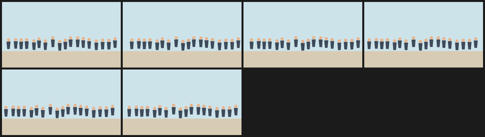

# 9. A crowd as a swarm of small marks

Eighteen people are eighteen rings in one `bend_swarm` for the bodies and eighteen in another for the heads. Each person is one agent per swarm, not a layer, which keeps the file to two statements.

The whole crowd drifts on one sine with a small `boil`. At this scale the marks read as a crowd; the pattern is about density and rhythm, not individual faces.



| | |
| --- | --- |
| Source | [`examples/patterns/09-crowd-swarm.ncel`](../../examples/patterns/09-crowd-swarm.ncel) |
| Size | **2,346 bytes** · **1,339 cl100k tokens** |
| Timing | 6 frames at 6 fps (1.00 s) · 360×200 |
| Render | `northcel film examples/patterns/09-crowd-swarm.ncel -o out/ --frames 0..5` |

## Why it works

Two swarms give two colours (coat and skin) while one translate keeps every person together. A crowd is the canonical swarm: many independent marks, one rule.

## The file

<!-- source: examples/patterns/09-crowd-swarm.ncel -->
```ncel
northcel "0.2.0-draft"

// A crowd as small marks: one swarm of heads and one of bodies, drifting on the
// same sine. Each person is one ring in each swarm, not a layer.

film CrowdSwarm(width: 360, height: 200, fps: 6, frames: 6, precision: 0.25px, seed: 909) {
  palette { ink: #22262E, coat: #3E4A5A, skin: #E8B48C, ground: #D8CBB4, sky: #CDE3EA }
  paper { color: #F6F1E7, antialias_grid: 4 }

  layer sky(color: $sky, rings: 1) { "0,0 1440,0 0,600 -1440,0" }
  layer ground(color: $ground, rings: 1) { "0,600 1440,0 0,200 -1440,0" }

  bend_swarm crowd_bodies(agents: 18, color: $coat, translate: (sin(t * 6.28318) * 8, 0), boil: 0.3px) {
    "55,483 48,0 -8,92 -32,0|142,478 48,0 -8,92 -32,0|208,484 48,0 -8,92 -32,0|276,481 48,0 -8,92 -32,0|363,494 48,0 -8,92 -32,0|426,471 48,0 -8,92 -32,0|502,495 48,0 -8,92 -32,0|593,458 48,0 -8,92 -32,0|676,502 48,0 -8,92 -32,0|744,486 48,0 -8,92 -32,0|808,457 48,0 -8,92 -32,0|893,459 48,0 -8,92 -32,0|961,468 48,0 -8,92 -32,0|1033,478 48,0 -8,92 -32,0|1119,496 48,0 -8,92 -32,0|1196,487 48,0 -8,92 -32,0|1272,488 48,0 -8,92 -32,0|1347,469 48,0 -8,92 -32,0"
  }
  bend_swarm crowd_heads(agents: 18, color: $skin, translate: (sin(t * 6.28318) * 8, 0), boil: 0.3px) {
    "99,463 -4,12 -10,7 -12,0 -10,-7 -4,-12 4,-12 10,-7 12,0 10,7|186,458 -4,12 -10,7 -12,0 -10,-7 -4,-12 4,-11 10,-8 12,0 10,8|252,464 -4,12 -10,7 -12,0 -10,-7 -4,-12 4,-12 10,-7 12,0 10,7|320,461 -3,11 -10,8 -13,0 -10,-8 -4,-11 4,-12 10,-7 13,0 10,7|407,474 -4,12 -10,7 -12,0 -10,-7 -4,-12 4,-12 10,-7 12,0 10,7|470,451 -4,11 -10,8 -12,0 -10,-8 -4,-11 4,-12 10,-7 12,0 10,7|546,475 -4,12 -10,7 -12,0 -10,-7 -4,-12 4,-12 10,-7 12,0 10,7|637,438 -4,12 -10,7 -13,0 -10,-7 -3,-12 3,-12 10,-7 13,0 10,7|720,482 -4,12 -10,7 -13,0 -10,-7 -3,-12 3,-11 10,-8 13,0 10,8|788,466 -4,11 -10,8 -12,0 -10,-8 -4,-11 4,-12 10,-7 12,0 10,7|852,437 -4,11 -10,8 -12,0 -10,-8 -4,-11 4,-12 10,-7 12,0 10,7|937,439 -4,12 -10,7 -12,0 -10,-7 -4,-12 4,-12 10,-7 12,0 10,7|1005,448 -4,11 -10,8 -13,0 -10,-8 -3,-11 3,-12 10,-7 13,0 10,7|1077,458 -4,12 -10,7 -12,0 -10,-7 -4,-12 4,-11 10,-8 12,0 10,8|1163,476 -4,12 -10,7 -13,0 -10,-7 -3,-12 3,-11 10,-8 13,0 10,8|1240,467 -3,11 -10,8 -13,0 -10,-8 -4,-11 4,-12 10,-7 13,0 10,7|1316,468 -4,12 -10,7 -12,0 -10,-7 -4,-12 4,-12 10,-7 12,0 10,7|1391,449 -4,12 -10,7 -12,0 -10,-7 -4,-12 4,-11 10,-8 12,0 10,8"
  }
}
```

## Pitfalls

- `agents:` is a declaration, not a multiplier. Eighteen people need eighteen rings in each swarm, and `agents: 18` to say so.
- A swarm has one colour and one translate. Two colours means two swarms (as here); per-person motion needs separate statements.
- Heads and bodies must share the same drift expression, or the crowd decapitates itself.

## Reproduce it

```console
$ northcel check examples/patterns/09-crowd-swarm.ncel
$ northcel film examples/patterns/09-crowd-swarm.ncel -o frames/ --frames 0..5
```

The contact sheet above is generated by `docs/scripts/build_docs_assets.py` from
those same frames. The docs check renders every pattern again and compares the
pixels, so the image and the file cannot drift apart.

Next: [patterns index](README.md) · [the guide](../guide/README.md) ·
[gallery](../gallery.md).
