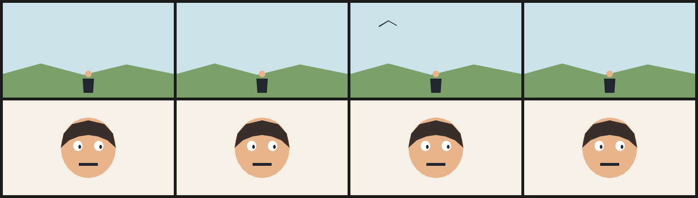

# 10. A two-shot film with a frame override

Two complete shots live in one file. Shot A sits at x = 0 and leaves at frame 4; shot B waits at x = +400 and arrives on the same frame. `step(4, f)` makes the change a cut rather than a pan.

A `frame 2` override adds one bird to shot A. That is the only per-frame delta: everything else is the base timeline.



| | |
| --- | --- |
| Source | [`examples/patterns/10-two-shot.ncel`](../../examples/patterns/10-two-shot.ncel) |
| Size | **2,151 bytes** · **1,004 cl100k tokens** |
| Timing | 8 frames at 8 fps (1.00 s) · 360×200 |
| Render | `northcel film examples/patterns/10-two-shot.ncel -o out/ --frames 0..7` |

## Why it works

Both shots are always in the document, so the cut is a translate, not a second file. The override adds a single beat without touching either shot's base layers.

## The file

<!-- source: examples/patterns/10-two-shot.ncel -->
```ncel
northcel "0.2.0-draft"

// A two-shot film. Shot A lives at x=0 and leaves at frame 4; shot B waits at
// x=+400 and arrives at the same frame. A frame override adds one bird in A.

film TwoShot(width: 360, height: 200, fps: 8, frames: 8, precision: 0.25px, seed: 1010) {
  palette { ink: #22262E, sky: #CDE3EA, hill: #7CA06A, skin: #E8B48C, hair: #3A2E2A, bird: #22262E }
  paper { color: #F6F1E7, antialias_grid: 4 }

  layer sky_a(color: $sky, rings: 1, translate: (-400 * step(4, f), 0)) { "0,0 1440,0 0,800 -1440,0" }
  layer hill_a(color: $hill, rings: 1, translate: (-400 * step(4, f), 0)) { "0,600 320,-88 360,96 360,-88 400,80 0,200 -1440,0" }
  layer figure_body(color: $ink, rings: 1, translate: (-400 * step(4, f), 0)) { "672,640 96,0 -8,120 -80,0" }
  layer figure_head(color: $skin, rings: 1, translate: (-400 * step(4, f), 0)) { "748,600 -5,16 -14,11 -18,0 -14,-11 -5,-16 5,-16 14,-11 18,0 14,11" }

  layer face_b(color: $skin, rings: 1, translate: (400 * (1 - step(4, f)), 0)) { "952,400 -8,66 -23,62 -37,53 -48,41 -56,25 -60,9 -60,-9 -56,-25 -48,-41 -37,-53 -23,-62 -8,-66 8,-66 23,-62 37,-53 48,-41 56,-25 60,-9 60,9 56,25 48,41 37,53 23,62" }
  layer hair_b(color: $hair, rings: 1, translate: (400 * (1 - step(4, f)), 0)) { "488,400 24,-120 72,-80 136,-32 136,32 72,80 24,120 -72,-64 -80,-32 -80,-12 -80,12 -80,32" }
  layer eye_b_l(color: #FFFFFF, rings: 1, translate: (400 * (1 - step(4, f)), 0)) { "672,384 -5,22 -15,16 -20,6 -20,-6 -15,-16 -5,-22 5,-22 15,-16 20,-6 20,6 15,16" }
  layer eye_b_r(color: #FFFFFF, rings: 1, translate: (400 * (1 - step(4, f)), 0)) { "848,384 -5,22 -15,16 -20,6 -20,-6 -15,-16 -5,-22 5,-22 15,-16 20,-6 20,6 15,16" }
  layer pupil_b_l(color: $ink, rings: 1, translate: (400 * (1 - step(4, f)), 0)) { "660,392 -4,12 -8,6 -8,-6 -4,-12 4,-12 8,-6 8,6" }
  layer pupil_b_r(color: $ink, rings: 1, translate: (400 * (1 - step(4, f)), 0)) { "836,392 -4,12 -8,6 -8,-6 -4,-12 4,-12 8,-6 8,6" }
  layer mouth_b(color: $ink, rings: 1, translate: (400 * (1 - step(4, f)), 0)) { "640,528 160,0 0,24 -160,0" }

  frame 2 {
    stroke bird(color: $bird, taper: (2.5, 1.5)) { (60, 50), (80, 38), (98, 48) }
  }
}
```

## Pitfalls

- Shot B must wait at least one canvas width away, or its edge is visible in shot A.
- Name the two shots' layers distinctly. If both use `sky`, the second replaces the first in the same paint slot.
- A `step` cut is instantaneous; if you want a pan, use `lerp` and give it two or three frames.

## Reproduce it

```console
$ northcel check examples/patterns/10-two-shot.ncel
$ northcel film examples/patterns/10-two-shot.ncel -o frames/ --frames 0..7
```

The contact sheet above is generated by `docs/scripts/build_docs_assets.py` from
those same frames. The docs check renders every pattern again and compares the
pixels, so the image and the file cannot drift apart.

Next: [patterns index](README.md) · [the guide](../guide/README.md) ·
[gallery](../gallery.md).
