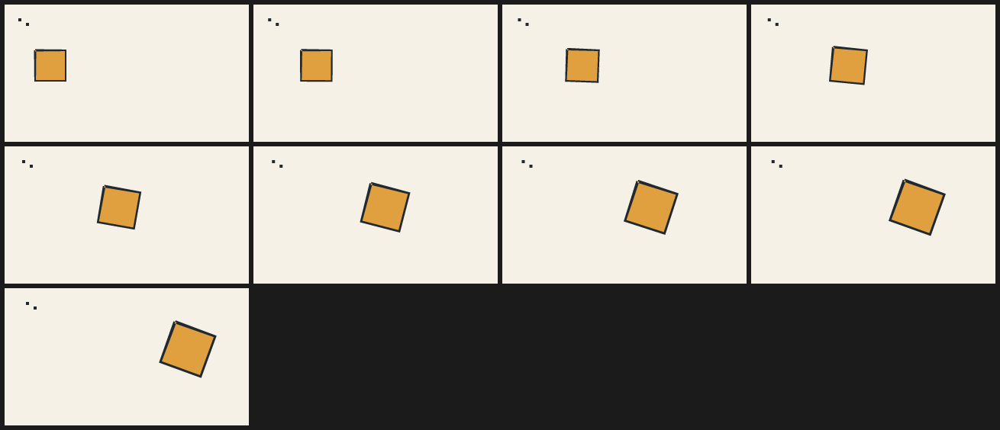

# 11. Intact cel motion: anchored scale and rotation

**522 bytes / 233 cl100k tokens; 9 frames at 24 fps, 320×180.**

The fill and its ink outline share one matrix. Continuous travel stays linear;
scale/rotation use bounded quintic easing. The independent swarm still runs
through Bend/HVM2 before its own named transform. No rig or raster is involved.

<!-- source: examples/patterns/11-intact-cel-motion.ncel -->
```ncel
northcel "0.3.0-draft"
film IntactCelMotion(width: 320, height: 180, fps: 24, frames: 9, precision: 0.25px) {
  paper { color: #F6F1E7, antialias_grid: 4 }
  cel badge(color: #E0A040, outline: (#202830, 3px)) { "160,240 160,0 0,160 -160,0" }
  transform badge(scale: lerp(1, 1.4, ease(t)), rotate: lerp(0, 20, ease(t)), anchor: (60, 80), translate: (lerp(0, 180, t), 0))
  bend_swarm sparks(agents: 2, color: #202830) { "72,72 16,0 0,16 -16,0|112,96 16,0 0,16 -16,0" }
  transform sparks(translate: (lerp(0, 10, t), 0))
}
```



```console
$ northcel check examples/patterns/11-intact-cel-motion.ncel
$ northcel film examples/patterns/11-intact-cel-motion.ncel -o intact-frames/
```

Pitfalls: a transform only changes previously painted marks; a later replacement
is not affected. A `transform all` placed last moves everything except paper.
Scaling below one does not magically extend a cropped background. And transform
in-betweens do not create new foot, arm or facial poses — inspect before claiming
a smoother animation. [Guide 15](../guide/15-fitting-transforms-and-inbetweens.md)
also covers round-trip fitting and rejected contour tweens.
