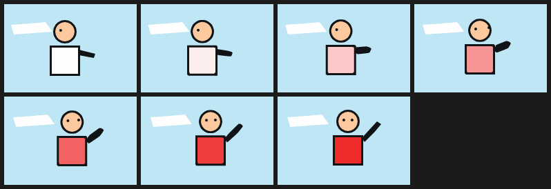

# 12. Polishing AI frames: `fit --stacked` + `tween --match`

**2,472 bytes; 7 frames at 12 fps, 192×128. Spec 0.4 (Python reference renderer).**

Independently generated key drawings never share contour topology, so the
ordered `tween` refuses them. This pattern is the workflow that fills the gaps
between such keys: stack each drawing into painter's-order shapes, match the
shapes, and write **one** film that keeps every key once and describes the
in-betweens with `morph`, `mix`, `opacity` and `frame A..B`.

## The workflow

```console
$ pip install 'northcel[fit]'
$ northcel fit key_a.png -o key_a.ncel --stacked --palette film-palette.json --receipt a.json
$ northcel fit key_b.png -o key_b.ncel --stacked --palette film-palette.json --receipt b.json
$ northcel tween key_a.ncel key_b.ncel -o tween.ncel --match --steps 6 --fps 12 \
      --colour-changes colour-changes.json --receipt tween.json
$ northcel film tween.ncel -o frames/
```

1. **One palette for the whole film.** `--palette` (a JSON list of `[r, g, b]`)
   keeps colour identity across drawings; a per-frame palette makes the same
   shirt two colours and nothing matches.
2. **`fit --stacked`** writes solid outer contours, biggest first, instead of a
   planar map. A hole whose source pixels are mostly paper (the sky between an
   arm and the body) stays as a paper-coloured shape (`--gap-fraction`, default
   0.5). A large hole in the ink colour is underpainted with the most common
   colour inside it (`--underpaint-min-area`, default 300 px²; `0` disables), so
   a fill that drifts during a morph uncovers skin rather than black. The output
   is a plain spec 0.3 scene.
3. **`tween --match`** pairs shapes by a Hungarian assignment on centroid
   distance and area ratio. A shape may change colour only along the pairs in
   `--colour-changes` (here white → red, a JSON list of `["#FEFEFE", "#EE2C2C"]`
   pairs); everything else must keep its colour. Shapes left over that sit inside
   a matched shape are matched again using that shape's motion. It also accepts
   planar fits; give `--image-a`/`--image-b` so the gap test uses the source
   pixels.
4. **Read the receipt.** It reports `matched_fraction`, the weighted
   `displacement_px`, the pairs and leftovers, and the mode it used. Below
   `--min-match` (0.5) or above `--max-displacement` (32 px) the transition is
   an explicit cut (`--fallback dissolve` for a dissolve), with the reason.
5. **Look at every in-between.** The tool cannot.

For a whole film use the Python API in `northcel.correspond` (keys with times,
one mode per transition: morph, cut, dissolve or hold); it is documented in
[the reference](../reference.md#python-api-for-polishing).

## The result

The keys are [`examples/polish/key_a.ncel`](../../examples/polish/key_a.ncel)
and [`key_b.ncel`](../../examples/polish/key_b.ncel), written by hand in the
stacked form. The film below is exactly what this command printed:

```console
$ northcel tween examples/polish/key_a.ncel examples/polish/key_b.ncel \
      -o examples/patterns/12-polishing-ai-frames.ncel --match --steps 6 --fps 12 \
      --colour-changes examples/polish/colour-changes.json --ink-switch-area-fraction 0.2
```

<!-- source: examples/patterns/12-polishing-ai-frames.ncel -->
```ncel
northcel "0.4.0-draft"

film Tween(width: 192, height: 128, fps: 12, frames: 7, precision: 0.25px-b63) {
  palette { c0: #BFE6F4, c1: #111416, c2: #FEFEFE, c3: #FCC89E, c4: #EE2C2C }
  paper { color: $c0, antialias_grid: 4 }
  def K0 {
    layer k0_0(color: $c1) { "264,240:yVyVzVyVzVyVVyVyVzVyVzVy2V2V1V2V1V2V" }
    layer k0_1(color: $c2) { "276,252:zVzV_VzV_VVzVzV_VzV_1V1V0V1V0V" }
    layer k0_2(color: $c1) { "420,160:SqLoGkCfAYASCLGGLCSAYAfCkGoLqSqYofkkfo" }
    layer k0_3(color: $c2) { "40,120:yTxTyTxTySxTySpxpx3X3X3X3X3X3X3X3X" }
    layer k0_4(color: $c3) { "408,160:SmNlJhFdEYESFNJJNFSEYEdFhJlNmSmYldhhdl" }
    layer k0_5(color: $c1) { "432,264:tbtbtbtbNt2Q1P2Q" }
    layer k0_6(color: $c1) { "336,152:TbPXPTTPXPbTbX" }
  }
  def K1 {
    layer k1_0(color: $c1) { "320,224:yVyVzVyVzVyVVyVyVzVyVzVy2V2V1V2V1V2V" }
    layer k1_1(color: $c4) { "332,236:zVzV_VzV_VVzVzV_VzV_1V1V0V1V0V" }
    layer k1_2(color: $c1) { "476,144:SqLoGkCfAYASCLGGLCSAYAfCkGoLqSqYofkkfo" }
    layer k1_3(color: $c2) { "57,120:yTxTyTxTySxTySpxpx3X3X3X3X3X3X3X3X" }
    layer k1_4(color: $c3) { "464,144:SmNlJhFdEYESFNJJNFSEYEdFhJlNmSmYldhhdl" }
    layer k1_5(color: $c1) { "488,240:r7r7r7r7tlBtBt3x3x" }
    layer k1_6(color: $c1) { "392,136:TbPXPTTPXPbTbX" }
    layer k1_7(color: $c1) { "440,136:TbPXPTTPXPbTbX" }
  }
  def T0(u: 0) {
    morph t0_0(color: $c1, u: u, samples: 50) { "264,240:yVyVzVyVzVyVVyVyVzVyVzVy2V2V1V2V1V2V" => "320,224:yVyVzVyVzVyVVyVyVzVyVzVy2V2V1V2V1V2V" }
    morph t0_1(color: mix($c2, $c4, u), u: u, samples: 43) { "276,252:zVzV_VzV_VVzVzV_VzV_1V1V0V1V0V" => "332,236:zVzV_VzV_VVzVzV_VzV_1V1V0V1V0V" }
    morph t0_2(color: $c1, u: u, samples: 30) { "420,160:SqLoGkCfAYASCLGGLCSAYAfCkGoLqSqYofkkfo" => "476,144:SqLoGkCfAYASCLGGLCSAYAfCkGoLqSqYofkkfo" }
    morph t0_3(color: $c2, u: u, samples: 39) { "40,120:yTxTyTxTySxTySpxpx3X3X3X3X3X3X3X3X" => "57,120:yTxTyTxTySxTySpxpx3X3X3X3X3X3X3X3X" }
    morph t0_4(color: $c3, u: u, samples: 24) { "408,160:SmNlJhFdEYESFNJJNFSEYEdFhJlNmSmYldhhdl" => "464,144:SmNlJhFdEYESFNJJNFSEYEdFhJlNmSmYldhhdl" }
    morph t0_5(color: $c1, u: u, samples: 24) { "432,264:tbtbtbtbNt2Q1P2Q" => "488,240:r7r7r7r7tlBtBt3x3x" }
    morph t0_6(color: $c1, u: u, samples: 24) { "336,152:TbPXPTTPXPbTbX" => "392,136:TbPXPTTPXPbTbX" }
    layer t0_b7(color: $c1, opacity: step(0.5, u)) { "440,136:TbPXPTTPXPbTbX" }
  }
  frame 0 {
    use K0
  }
  frame 1..5 {
    use T0(u: smoothstep(0, 6, f))
  }
  frame 6 {
    use K1
  }
}
```



How to read it: `def K0`/`K1` hold each key once; `frame 0` and `frame 6` show
them. `def T0(u: 0)` is the transition: each matched pair is a `morph` (the shirt
also `mix`es white to red); the arm changes vertex count, which `morph` handles by
arclength resampling. The second eye exists only in key B, so it appears with
`opacity: step(0.5, u)`. Ink shapes bigger than the switch threshold would also
switch at `u = 0.5` instead of morphing; this tiny canvas raises
`--ink-switch-area-fraction` so the outlines morph too. `frame 1..5` uses `T0`
with `u: smoothstep(0, 6, f)`, so `u` never reaches a key exactly.

## Pitfalls

- **A match is not anatomy.** It shows contours can be interpolated without
  folding. A crouch turning into a jump, a spin or a landing needs a drawn
  in-between key; morphing it produces a plausible-looking but wrong pose. Use a
  cut, or draw the missing key and tween twice.
- **Unmatched shapes pop at `u = 0.5`** at their key's position, not at the
  in-between position: in frame 3 above the second eye sits on the edge of a
  head that is still moving. Review those frames; move or redraw if it matters.
- **Painter's order is fixed per transition** (by mean area). Two overlapping
  shapes that swap size rank can swap stacking for the whole window.
- **Big same-colour fields switch** instead of morphing (backgrounds bulge around
  a moving figure when morphed); the thresholds are canvas fractions
  (`--switch-area-fraction`, `--ink-switch-area-fraction`).
- **The film needs the Python reference.** It is spec 0.4; the native runtime
  0.4.0 implements spec 0.3, and the launchers route it to the labelled reference.
  The stacked keys alone are spec 0.3 and render natively.
- **Size.** Each matched pair stores both rings once per transition, on top of
  the keys. The film is still far smaller than a scene per frame.
